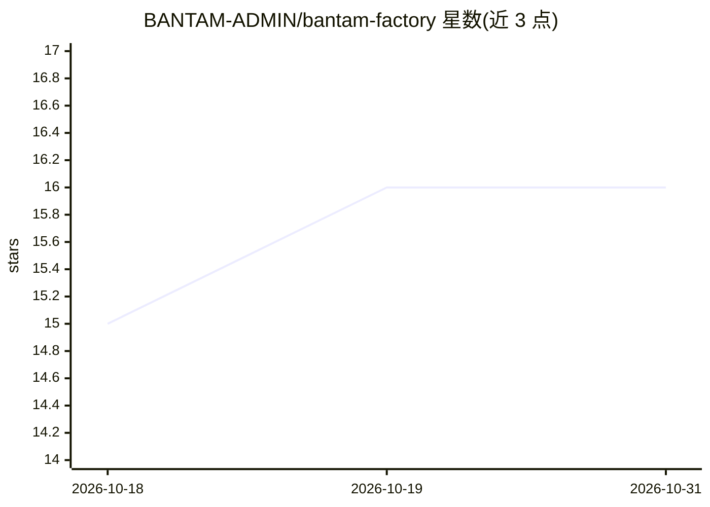

# BANTAM-ADMIN/bantam-factory

⭐ 16 · JavaScript · Apache-2.0 · 推送 2026-10-27 · [GitHub](https://github.com/BANTAM-ADMIN/bantam-factory) · [官网](https://bantam-admin.github.io/bantam-factory/) · 个人维护

**本地模型编程代理框架：让编码 agent 的动作可验证**

面向本地模型（或 Codex API 模型）的编码代理框架（harness），提供 read_file/write_file/patch/shell 等 12 种动作，动作经 JSON Schema 校验、代码在沙箱中运行，按 TDD 默认带 709 个测试文件。支持会话内 turn 限额、输出检查点续写、团队/三人并行模式（Luna/Sol/本地模型同跑）。2.0 增 Jev 模式：以 DiffusionGemma 26B 作为本地决策引擎，给出校准概率的快速判定；另提供可选 REA 逆向工程 MCP 插件。Jev 模式需 NVIDIA GPU 约 22GB 空闲与 vLLM。

## 筛选速览

| 维度 | 判定 | 备注 |
|---|---|---|
| AI 角色 | `ai-ecosystem` | LLM/agent 周边工具 |
| 许可风险 | `permissive` | Apache-2.0 |
| 部署形态 | `library` | 以包/库形式分发 |
| 模型依赖 | local-ok | 支持本地模型 |
| 硬件要求 | — | 无带数字的原话,不猜 |
| 安装摩擦 | `low` | 无编译、无系统依赖或容器化 |
| 成熟度 | — | 结构信号不足 |

## 能力要点

- 12 种动作均经 schema 校验，代码在沙箱运行，默认 TDD（709 个测试文件）
- Jev 模式：DiffusionGemma 26B 本地决策引擎，毫秒级校准概率判定
- 中断的文件写入保存检查点并从保存前缀续写，不完整命令不执行
- 可选 REA 逆向工程插件（SHA-256 校验的固定构建）

## 适用场景

- 用本地或 API 模型执行可验证的编码任务
- 在代理任务中调用本地小模型做快速是/否/选择判定
- 对 ROM、可执行文件、Electron 应用做逆向分析任务

## 场景标签

`编码 Agent` · 领域:编码与开发

## 证据(README 行号)

> L17: Bantam is a bantamweight local-model coding agent harness designed to turn raw model intelligence into reliable, ve
> L31:   User[User Request] --> Agent[Agent: src/agent.js]

## 星数曲线

2026-10-18 15 → 2026-10-31 16（+1）

---
*卡片 v1 · prompt 1.4 · 生成 2026-10-30 · 置信度 high · 依据 README sha `967fdf7c7a6e` · [字段定义](../../DATASET.md)*
