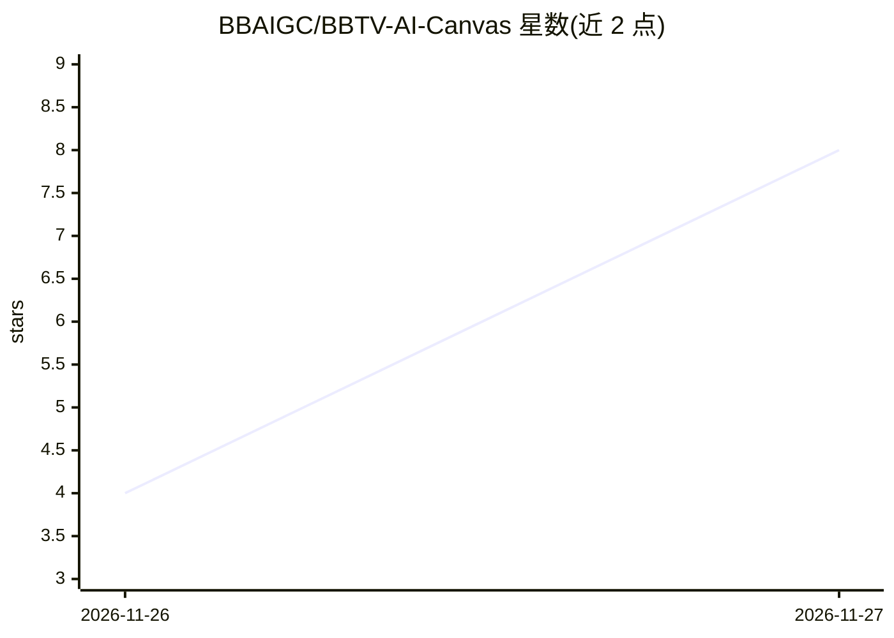

# BBAIGC/BBTV-AI-Canvas

⭐ 8 · 推送 2026-11-26 · [GitHub](https://github.com/BBAIGC/BBTV-AI-Canvas) · [官网](https://bbtv.ainivox.cn/) · 组织维护 · 中文 README

**面向 Windows 创作者的本地 AI 无限画布：图片视频生成与放大**

Windows 本地运行的 AI 无限画布软件，把参考图、剧本、分镜与生成结果放在同一画布。底层走 ComfyUI 推理引擎，提供图片生成与编辑、提示词反推、MiniMax H3 视频生成与人物替换、SeedVR2/VOSR2 高清放大等操作，无需手动搭建节点工作流；通过统一资源库导入模型，支持复用已有 ComfyUI 与权重。本地功能免费且不依赖 API，云端服务需自行填写接口配置。v0.1.55 起提供标准 MCP 接口，Codex、Claude Code 等智能体可直接操作画布节点、导入素材与提交生成队列。程序源码未在本仓库发布，仓库仅提供安装包索引与文档。

## 筛选速览

| 维度 | 判定 | 备注 |
|---|---|---|
| AI 角色 | `ai-native` | 本体是模型或模型工具 |
| 许可风险 | `none` | — |
| 部署形态 | `None` |  |
| 模型依赖 | — | README 未给出锁定关系 |
| 硬件要求 | — | 无带数字的原话,不猜 |
| 安装摩擦 | `low` | 无编译、无系统依赖或容器化 |
| 成熟度 | — | 结构信号不足 |

## 能力要点

- 无限画布整合图片生成、反推提示词、分镜、高清放大与视频生成
- 通过 MCP 让智能体操作真实画布（HTTP/stdin 两种接入方式）
- 复用已有 ComfyUI 与模型，统一资源库分层下载（基础 76.30 GB）
- 提供三套智能体部署提示词：按配置推荐、轻量、全量

## 适用场景

- 在一张画布上完成从参考图到多镜头视频的创作流程
- 用本地模型批量生成与放大图片而不产生按次费用
- 让 Codex/Claude Code 等智能体代为操作画布与生成队列

## 场景标签

`图像生成` `视频生成` · 领域:内容生成

## 证据(README 行号)

> L27: **BBTV AI Canvas（BBTV 无限画布）** 是 Windows 本地 AI 无限画布创作软件，支持 ComfyUI 图片与视频生成、智能分镜、高清放大及 MCP 智能体控制。本地功能永久免费，使用本地模型无需购买 
> L54: **把想法、参考图、分镜和生成结果放进一张无限画布，接着创作。** BBTV 将常用的本地图片、视频与放大流程做成可以直接使用的操作：选择模型、提供参考、写下要求，无需手动搭建 ComfyUI 节点工作流。
> L143: BBTV 提供标准 MCP，让智能体直接操作**正在打开的真实画布**。创建节点、填写提示词、连接素材、选择模型、加入生成队列，都会即时显示在软件里；生成结果也保存在同一画布中。

## 星数曲线

2026-11-26 4 → 2026-11-27 8（+4）

---
*卡片 v1 · prompt 1.4 · 生成 2026-11-26 · 置信度 high · 依据 README sha `e1d740a31fd0` · [字段定义](../../DATASET.md)*
