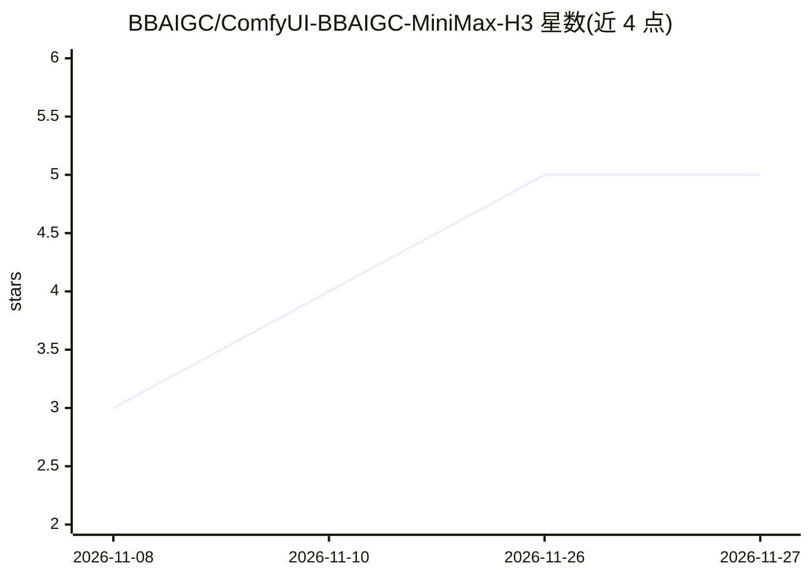

# BBAIGC/ComfyUI-BBAIGC-MiniMax-H3

⭐ 5 · Python · 推送 2026-11-02 · [GitHub](https://github.com/BBAIGC/ComfyUI-BBAIGC-MiniMax-H3) · 个人维护 · 中文 README

**ComfyUI 工作台：参考图加剧本全自动生成分镜视频**

运行在 ComfyUI 上的工作流整合项目：输入一张参考图与一句话/剧本，由本地语言模型规划镜头与时长，逐镜生成分镜图，再由本地 MiniMax H3 模型逐镜生成视频并合成为完整成片，单任务最多 100 镜头、目标总时长上限 25 分钟。文字规划与图片生成可分别切换本地模型或用户自有 API；支持语音输入写剧本、换图续跑、指定镜头重做。安装方式包括智能体提示词部署与 PowerShell 安装脚本，模型按档位单独下载，完整分镜生图需另装 Qwen 图片模型与 Ollama。

## 筛选速览

| 维度 | 判定 | 备注 |
|---|---|---|
| AI 角色 | `ai-native` | 本体是模型或模型工具 |
| 许可风险 | `none` | — |
| 部署形态 | `desktop` | 安装包/桌面程序 |
| 模型依赖 | local-ok | 支持本地模型 |
| 硬件要求 | — | 无带数字的原话,不猜 |
| 安装摩擦 | `low` | 无编译、无系统依赖或容器化 |
| 成熟度 | — | 结构信号不足 |

## 能力要点

- 参考图+剧本→AI 分镜→分镜生图→本地视频生成→成片的一条流程
- 单任务最多 100 镜头、每镜 1～15 秒，支持暂停续跑与换图重做
- 文字规划与图片生成本地/API 双路线，视频由本地 H3 生成
- 剧本框内置连续语音识别，字幕按 Whisper 词级时间戳分段

## 适用场景

- 用一张参考图和一段剧本自动产出完整短片
- 长视频按镜头批量生成并自动合成
- 已有分镜图，只补本地视频生成环节
- 在剧本框用语音口述代替打字

## 场景标签

`图像生成` `视频生成` `语音识别` · 领域:内容生成

## 证据(README 行号)

> L15: **放一张参考图，写一句话、一段故事或完整剧本，把从想法到成片的流程交给工作台。** 配置好模型，开启“AI 分镜”和“生图后生成视频”，点击运行，工作台会规划镜头、分配时长、生成分镜图、逐镜生成视频，最后合成完整成片。文字规划与
> L133: |Ollama|ollama.com|使用本地 AI 分镜/提示词规划时需要；云端文字服务可选|
> L156: 模型、依赖插件与本项目各自遵循其许可证。BBAIGC 提供工作台与流程整合，上游模型及节点作者保留各自署名。

## 星数曲线

2026-11-08 3 → 2026-11-27 5（+2）

---
*卡片 v1 · prompt 1.4 · 生成 2026-11-26 · 置信度 high · 依据 README sha `2e3a2042b56a` · [字段定义](../../DATASET.md)*
