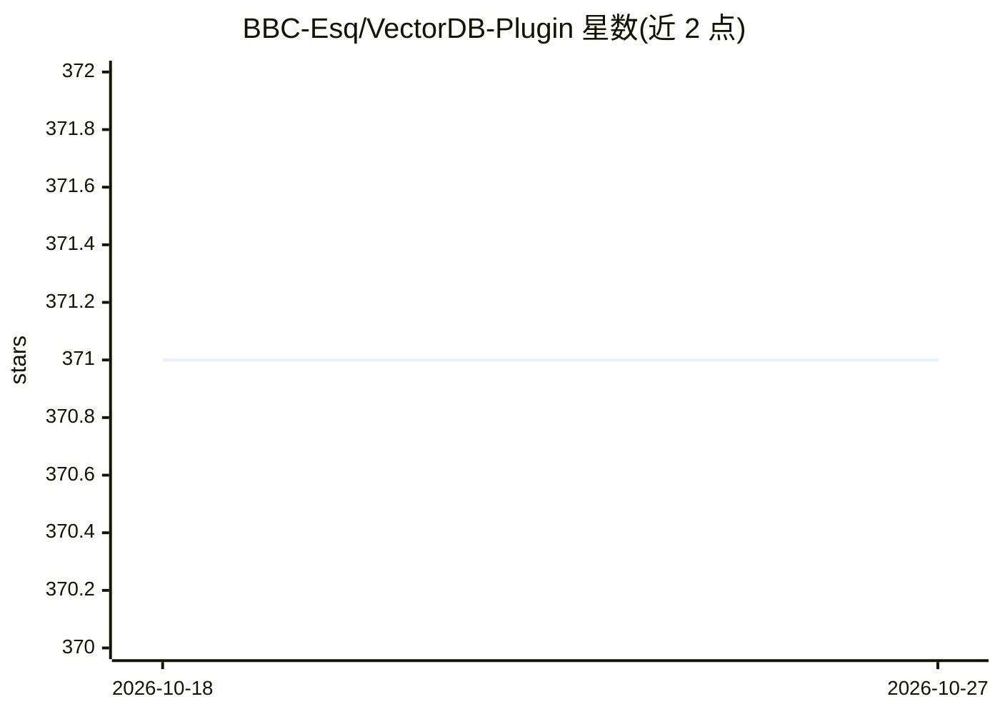

# BBC-Esq/VectorDB-Plugin

⭐ 371 · Python · 推送 2026-10-23 · [GitHub](https://github.com/BBC-Esq/VectorDB-Plugin) · [官网](https://www.youtube.com/@AI_For_Lawyers) · 个人维护

**Windows 本地 RAG 问答程序：对文档/音视频建向量库并作答**

面向 Windows 用户的本地检索增强生成（RAG）桌面程序：将 PDF、Office 文档、图片、音频等多种格式文件抽取文本、生成图像描述或转写语音后嵌入本地向量数据库；提问时可键入或语音录制，检索相关片段送至 LLM（本地模型、Kobold、LM Studio 或 ChatGPT）生成回答，可选文字转语音朗读。安装程序自动检测硬件，无 NVIDIA GPU 时安装 CPU-only 版本并使用较小模型。仅支持 Windows，需 Python 3.11–3.14 与 Visual C++ Build Tools。

## 筛选速览

| 维度 | 判定 | 备注 |
|---|---|---|
| AI 角色 | `ai-native` | 本体是模型或模型工具 |
| 许可风险 | `none` | — |
| 部署形态 | `None` |  |
| 模型依赖 | — | README 未给出锁定关系 |
| 硬件要求 | — | 无带数字的原话,不猜 |
| 安装摩擦 | `low` | 无编译、无系统依赖或容器化 |
| 成熟度 | — | 结构信号不足 |

## 能力要点

- 支持文档/图片/音频约 20 种输入格式的摄取与处理
- 文本或语音提问，检索后交 LLM 生成回答
- 本地模型、Kobold、LM Studio、ChatGPT 多种 LLM 后端可选
- 安装器自动检测硬件，无 GPU 时回退 CPU-only 小模型

## 适用场景

- 对本地文档、音频、视频建库后直接问答
- 不依赖云端、在本地完成文件检索式问答
- 用语音提问并让程序朗读回答

## 场景标签

`RAG` `文档问答` · 领域:知识与检索

## 证据(README 行号)

> L3: ### Create and search a vector database from a wide variety of file types and get more reliable responses from an LL
> L67: |🤖 **Generate**|Sent to an LLM (Local Model, Kobold, LM Studio, or ChatGPT)|

## 星数曲线

2026-10-18 371 → 2026-10-27 371（+0）

---
*卡片 v1 · prompt 1.4 · 生成 2026-10-21 · 置信度 high · 依据 README sha `2688899f16b3` · [字段定义](../../DATASET.md)*
