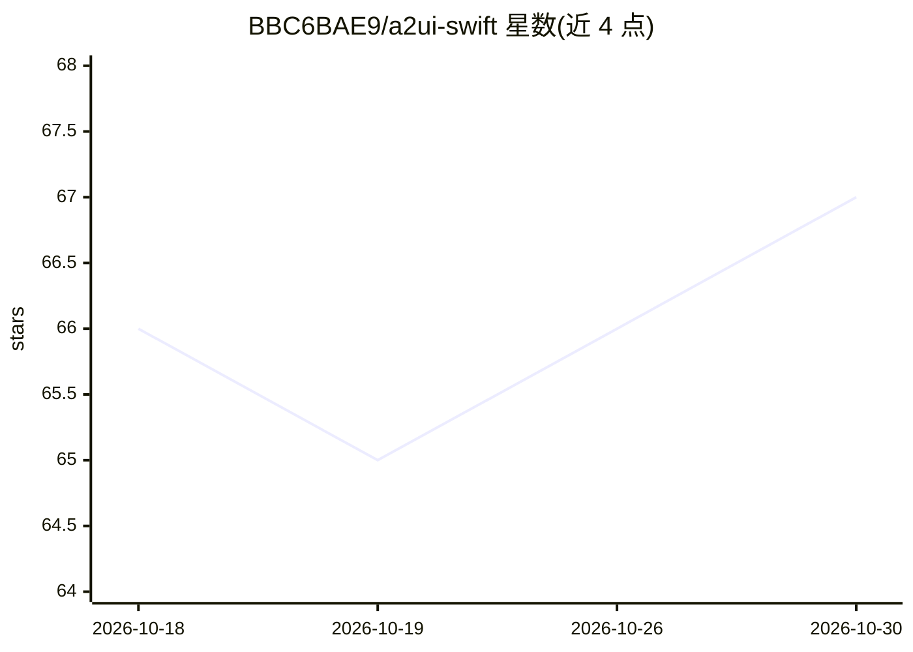

# BBC6BAE9/a2ui-swift

⭐ 67 · Swift · MIT · 推送 2026-09-24 · [GitHub](https://github.com/BBC6BAE9/a2ui-swift) · [官网](https://bbc6bae9.github.io/a2ui-swift/documentation/) · 个人维护

**把 AI 生成的 A2UI JSON 渲染为 Apple 原生 UI 的 Swift SDK**

A2UI 协议（Google 开源的 agent-to-user 界面协议）在 Apple 平台的社区渲染器，被列入官方渲染器生态。它接收 agent 产出的声明式 A2UI JSON，通过 SwiftUI/UIKit/AppKit 渲染为原生控件，支持 17 个内置组件、双向数据绑定、表达式与检查、模板与本地化。客户端通过 catalog 控制允许的组件与数据流，agent 不在应用内执行代码。以 Swift Package Manager 分发，要求 iOS/tvOS 17、macOS 14、watchOS 10、visionOS 1 以上，附带 300+ 测试与多个示例应用。

## 筛选速览

| 维度 | 判定 | 备注 |
|---|---|---|
| AI 角色 | `ai-ecosystem` | LLM/agent 周边工具 |
| 许可风险 | `permissive` | MIT |
| 部署形态 | `None` |  |
| 模型依赖 | — | README 未给出锁定关系 |
| 硬件要求 | — | 无带数字的原话,不猜 |
| 安装摩擦 | `low` | 无编译、无系统依赖或容器化 |
| 成熟度 | — | 结构信号不足 |

## 能力要点

- SwiftUI/UIKit/AppKit 三渲染器共享同一协议模型
- 支持 A2UI v0.9/v0.9.1：消息处理、surface、数据模型更新、action、表达式、模板
- 自定义组件 catalog：向 agent 暴露自有可信组件而不允许任意代码执行
- 300+ 测试覆盖协议解码、表达式求值、数据绑定与渲染行为

## 适用场景

- 让 agent 返回可交互的原生表单/审批卡/列表而非纯文本
- 在模型输出与渲染控件之间维持显式安全边界
- 复用自有设计系统组件，让 agent 用可信积木组合 UI

## 场景标签

 · 领域:LLM 基础设施/客户端渲染

## 证据(README 行号)

> L22: Agent -> declarative A2UI JSON -> A2UI-Swift -> SwiftUI / UIKit / AppKit
> L27: A2UI is an open protocol from Google for agent-to-user interfaces. **A2UI-Swift** is a community-maintained Apple-p

## 星数曲线

2026-10-18 66 → 2026-10-30 67（+1）

---
*卡片 v1 · prompt 1.4 · 生成 2026-10-24 · 置信度 high · 依据 README sha `b6b2c0dfa3da` · [字段定义](../../DATASET.md)*
