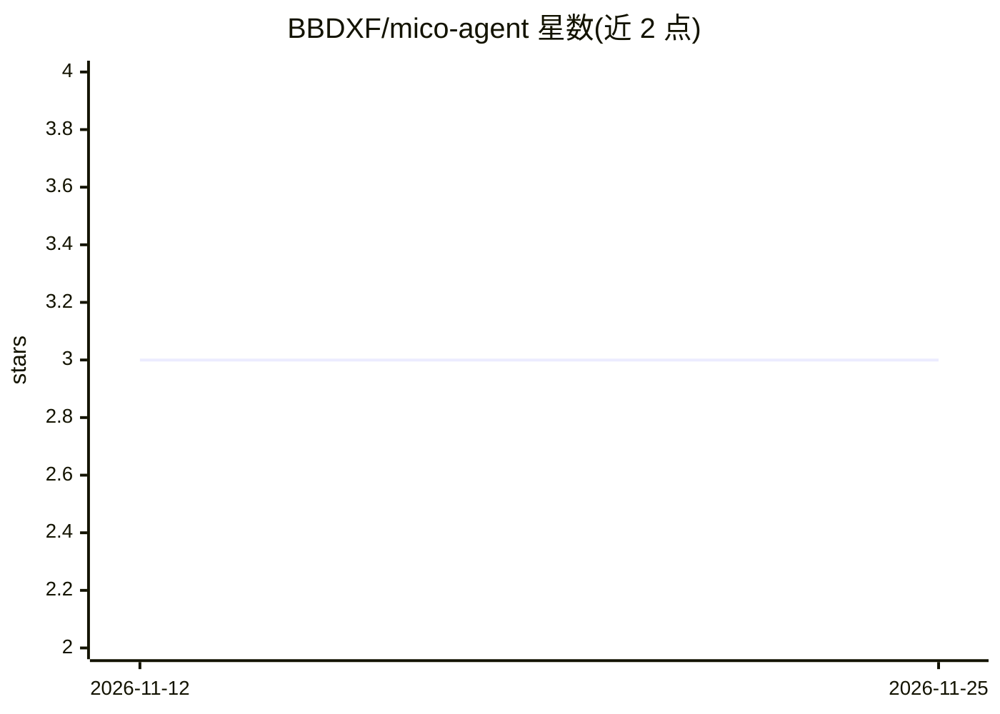

# BBDXF/mico-agent

⭐ 3 · C++ · 推送 2026-11-11 · [GitHub](https://github.com/BBDXF/mico-agent) · 个人维护 · 中文 README

**运行在小爱音箱里的轻量 AI Agent：语音点歌与工具调用**

以约 470 KB 的 C++14 二进制加 Lua 脚本直接运行在小爱音箱 Pro（armv7，256 MB 内存）上的 Agent，读取固件语音识别日志作为语音入口，通过 OpenAI 兼容接口调用大模型完成多轮工具调用；"播放 X" 走本地拼音模糊搜索的快路径直接播放，歧义或闲聊才交给大模型。支持飞牛 NAS（fnOS 飞牛音乐）本地曲库与在线音乐源插件、Lua 插件在线编辑、Web 控制台配置与对话查看、边播边存到 NAS。语音接管默认关闭，需在配置页开启。

## 筛选速览

| 维度 | 判定 | 备注 |
|---|---|---|
| AI 角色 | `ai-native` | 本体是模型或模型工具 |
| 许可风险 | `none` | — |
| 部署形态 | `None` |  |
| 模型依赖 | — | README 未给出锁定关系 |
| 硬件要求 | — | 无带数字的原话,不猜 |
| 安装摩擦 | `high` | 编译与系统依赖俱全 |
| 成熟度 | — | 结构信号不足 |

## 能力要点

- 本地拼音模糊搜索快路径点歌，同音字/模糊音匹配，不消耗 token
- OpenAI 兼容接口（默认 SiliconFlow Qwen/Qwen3-8B）多轮工具调用
- Lua 插件与工具可在网页在线编辑、启停，保存即生效
- 内置流代理边下边播，支持 WebDAV 边播边存到 NAS

## 适用场景

- 用自然语言在音箱上点播飞牛 NAS 里的本地曲库
- 本地没有的歌通过在线音乐源插件在线播放
- 让音箱回答问题、调用 HTTP 接口或执行音箱上的命令
- 通过网页查看对话每一步并在线修改配置和插件

## 场景标签

`语音 Agent` `聊天机器人` · 领域:对话与助手

## 证据(README 行号)

> L3: 运行在**小爱音箱内部**的轻量 AI Agent。不需要 NAS 上的额外服务、不需要中转服务器：一个约 470 KB 的 C++ 二进制 + 几个 Lua 脚本，
> L15: |点歌|每句话都走大模型|**快路径**：“播放 X”在本地拼音模糊搜索后直接播放，毫秒级、不消耗 token；只有歧义或闲聊才交给大模型|
> L32: - **Agent**：OpenAI 兼容接口（默认 SiliconFlow `Qwen/Qwen3-8B`），多轮工具调用。

## 星数曲线

2026-11-12 3 → 2026-11-25 3（+0）

---
*卡片 v1 · prompt 1.4 · 生成 2026-11-22 · 置信度 high · 依据 README sha `d78a128b55bc` · [字段定义](../../DATASET.md)*
