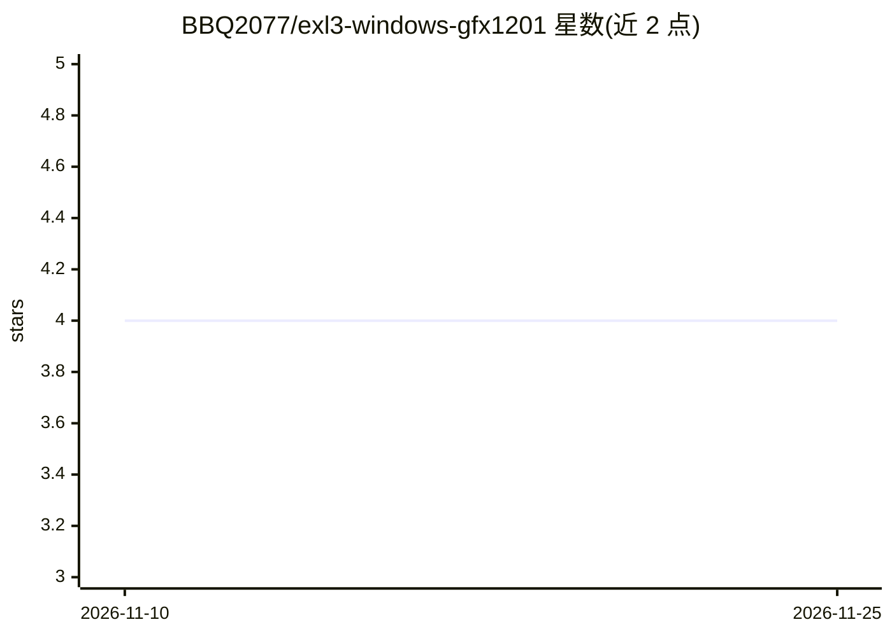

# BBQ2077/exl3-windows-gfx1201

⭐ 4 · Python · 推送 2026-10-18 · [GitHub](https://github.com/BBQ2077/exl3-windows-gfx1201) · [官网](https://github.com/BBQ2077/GGUFRun) · 个人维护 · 中文 README

**RX 9070 (gfx1201) 原生 Windows 上跑 EXL3 量化模型的免安装运行时**

面向 AMD RX 9070 系列显卡（gfx1201）用户的 ExLlamaV3 推理环境：以 Release 压缩包分发，内附 Python 3.12、PyTorch ROCm 构建、Triton Windows 与针对 gfx1201 预编译的 C++/HIP 扩展，解压即可运行，不需 WSL、HIP SDK 或自行编译。提供 OpenAI 兼容 API 服务器、llama.cpp WebUI、终端聊天入口，支持 DFlash2 投机解码、多路并行生成、多轮前文缓存（RAM/SSD）与视觉输入；EXL3 模型的权重与 KV cache 全部放显存，模型大小加 context 必须装入显存。

## 筛选速览

| 维度 | 判定 | 备注 |
|---|---|---|
| AI 角色 | `ai-ecosystem` | LLM/agent 周边工具 |
| 许可风险 | `none` | — |
| 部署形态 | `desktop` | 安装包/桌面程序 |
| 模型依赖 | local-ok | 支持本地模型 |
| 硬件要求 | — | 无带数字的原话,不猜 |
| 安装摩擦 | `medium` | 含编译或系统依赖之一 |
| 成熟度 | — | 结构信号不足 |

## 能力要点

- 针对 gfx1201 预编译的 ExLlamaV3 HIP 扩展，免 WSL/SDK/编译
- OpenAI 兼容 API 服务器（仅监听 127.0.0.1）与 llama.cpp WebUI 聊天页面
- DFlash2 投机解码、--parallel 1~8 多路并行、--auto-draft(-accept) 自动调草稿深度
- 前文缓存三层：GPU、系统 RAM、SSD（重开 server 后仍有效）

## 适用场景

- 在原生 Windows 上不装 WSL/HIP SDK 直接加载 EXL3 量化模型
- 搭配 GGUFRun 图形界面选模型、调参数、一键启动推理服务
- 通过 OpenAI 兼容 API 把本地模型接入其他程序
- 带图对话（视觉塔可选 off/gpu/ram 三种放置方式）

## 场景标签

`推理引擎` · 领域:训练与推理

## 证据(README 行号)

> L1: # EXL3 Runtime for AMD RX 9070（gfx1201）— 原生 Windows
> L3: 在 **原生 Windows** 上用 AMD RX 9070 系列顯卡跑 ExLlamaV3（EXL3 量化模型）的免安裝執行環境。不需要 WSL、Linux、Visual Studio、ROCm／HIP SDK，也不用自己編譯：
> L7: - `server.py`：OpenAI 相容 API 伺服器，附 llama.cpp 網頁介面，支援思考模式、工具呼叫、DFlash2 投機解碼、多輪前文快取、看圖。

## 星数曲线

2026-11-10 4 → 2026-11-25 4（+0）

---
*卡片 v1 · prompt 1.4 · 生成 2026-11-21 · 置信度 mid · 依据 README sha `5bb1bd178cc7` · [字段定义](../../DATASET.md)*
