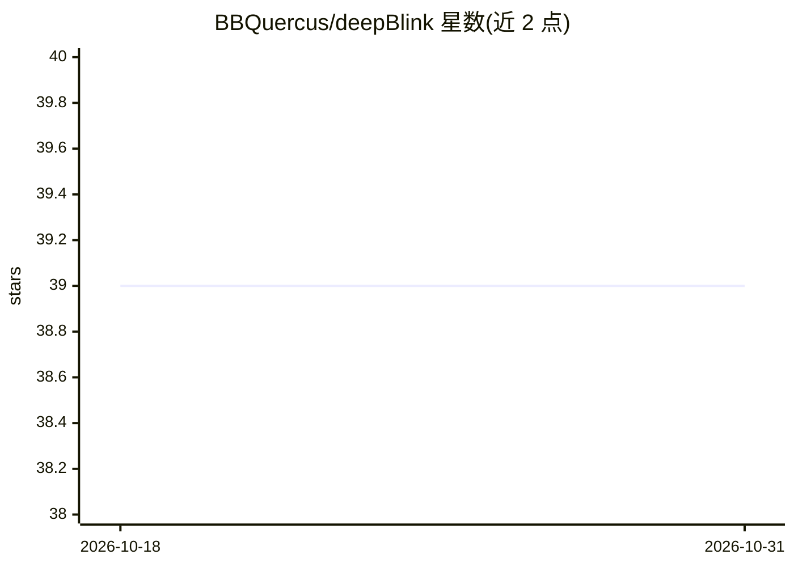

# BBQuercus/deepBlink

⭐ 39 · Python · NOASSERTION · 推送 2026-10-13 · [GitHub](https://github.com/BBQuercus/deepBlink) · [官网](https://academic.oup.com/nar/advance-article/doi/10.1093/nar/gkab546/6312733) · 组织维护

**显微镜衍射极限光点的深度学习检测与定位工具**

面向生物医学显微成像的 Python 包与命令行工具：用神经网络自动检测并定位单蛋白、结构域、mRNA 等形成的衍射极限光点，替代需人工设定强度阈值与光点尺寸的 Laplacian of Gaussian 类传统算子。以 pip/conda 安装，提供 deepblink predict 命令行推理接口，可加载预训练或自定义模型，支持 GPU（需 tensorflow-gpu 配套 CUDA/cuDNN），另有 KNIME 推理节点。配套论文发表于 Nucleic Acid Research。

## 筛选速览

| 维度 | 判定 | 备注 |
|---|---|---|
| AI 角色 | `ai-native` | 本体是模型或模型工具 |
| 许可风险 | `none` | NOASSERTION |
| 部署形态 | `library` | 以包/库形式分发 |
| 模型依赖 | — | README 未给出锁定关系 |
| 硬件要求 | — | 无带数字的原话,不猜 |
| 安装摩擦 | `medium` | 含编译或系统依赖之一 |
| 成熟度 | — | 结构信号不足 |

## 能力要点

- 神经网络检测定位衍射极限光点，无需人工设定阈值
- 提供命令行推理接口，支持预训练或自定义模型
- GPU 支持可选（tensorflow-gpu + CUDA/cuDNN）
- 提供 KNIME 推理节点

## 适用场景

- 检测显微图像中单分子/mRNA 光点
- 批量处理文件夹内图像并输出定位结果
- 用自己的数据训练自定义检测模型

## 场景标签

`目标检测` · 领域:感知与多模态

## 证据(README 行号)

> L11: Threshold independent detection and localization of diffraction-limited spots.
> L22: relies on neural networks to automatically find spots without the need for

## 星数曲线

2026-10-18 39 → 2026-10-31 39（+0）

---
*卡片 v1 · prompt 1.4 · 生成 2026-10-25 · 置信度 high · 依据 README sha `595199c3902c` · [字段定义](../../DATASET.md)*
