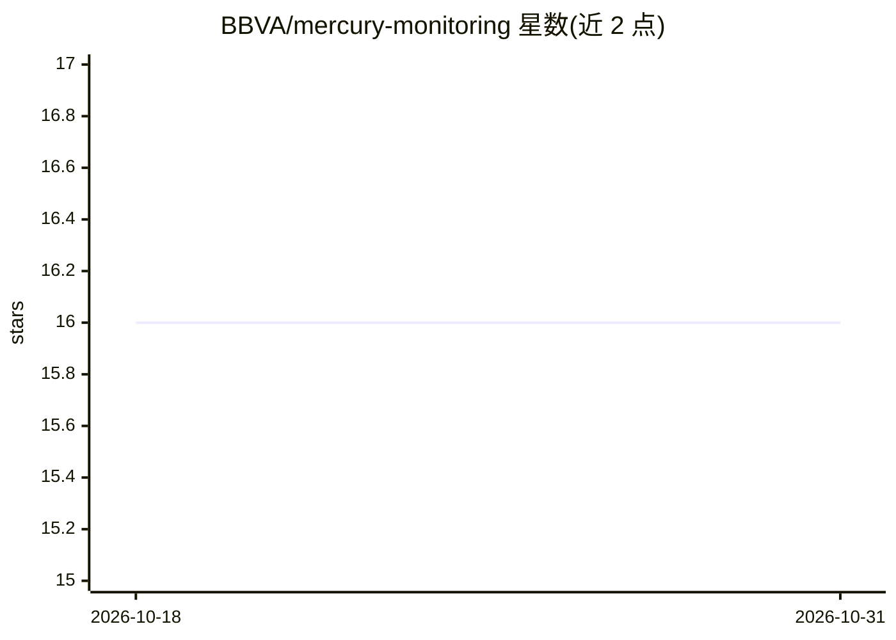

# BBVA/mercury-monitoring

⭐ 16 · Jupyter Notebook · Apache-2.0 · 推送 2026-06-18 · [GitHub](https://github.com/BBVA/mercury-monitoring) · 组织维护

**检测数据漂移与模型性能退化的 Python 监控库**

BBVA 数据科学与机器学习工程师团队维护的 Python 库，用于监控数据漂移与模型漂移：检测整体数据分布 P(X)、各特征边际分布 P(Xi) 的统计变化，以及在无法获取真实标签时估算模型性能。多数漂移检测类提供 calculate_drift() 方法输出是否检出漂移，用户可据此触发重训或告警。支持 Python 3.9–3.13，Apache 2 许可，通过 pip 安装，附文档站与 notebook 教程。

## 筛选速览

| 维度 | 判定 | 备注 |
|---|---|---|
| AI 角色 | `ai-ecosystem` | LLM/agent 周边工具 |
| 许可风险 | `permissive` | Apache-2.0 |
| 部署形态 | `library` | 以包/库形式分发 |
| 模型依赖 | — | README 未给出锁定关系 |
| 硬件要求 | — | 无带数字的原话,不猜 |
| 安装摩擦 | `low` | 无编译、无系统依赖或容器化 |
| 成熟度 | — | 结构信号不足 |

## 能力要点

- 检测整体分布 P(X) 与各特征边际 P(Xi) 的漂移
- 无真实标签场景下的模型性能估算
- 漂移检测类提供统一的 calculate_drift() 方法

## 适用场景

- 上线模型运行期监控数据分布变化
- 缺少标签时估算模型性能是否退化
- 漂移检出后触发重训或告警流程

## 场景标签

`MLOps` · 领域:训练与推理

## 证据(README 行号)

> L11: ***mercury-monitoring*** is a library to monitor data and model drift. It contains a set of utilities which you can
> L57: This library is currently maintained by a dedicated team of data scientists and machine learning engineers from BBV

## 星数曲线

2026-10-18 16 → 2026-10-31 16（+0）

---
*卡片 v1 · prompt 1.4 · 生成 2026-10-30 · 置信度 high · 依据 README sha `3ed1dcfd3a40` · [字段定义](../../DATASET.md)*
