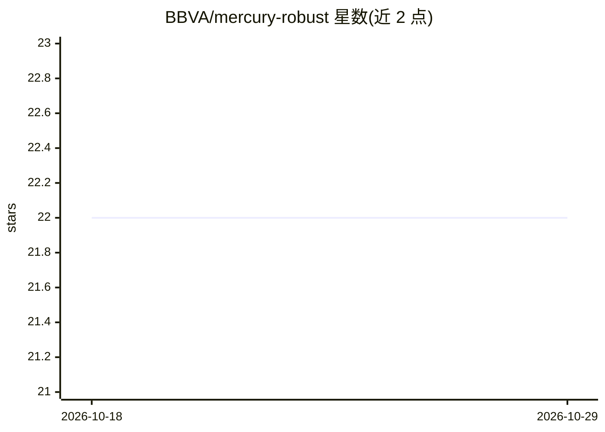

# BBVA/mercury-robust

⭐ 22 · Python · Apache-2.0 · 推送 2026-06-18 · [GitHub](https://github.com/BBVA/mercury-robust) · [官网](https://bbva.github.io/mercury-robust/) · 组织维护

**面向数据科学家的 ML 模型与数据集健壮性测试框架**

BBVA 开源的 Python 库，用于对机器学习模型和数据集执行健壮性测试。提供 Data Tests（如群组性能/公平性检查、线性组合、数据漂移）与 Model Tests（如 ModelSimplicityChecker 检查简单基线是否达到同等性能、特征重要性边际贡献检查）两类测试，并可用 TestSuite 容器分组批量执行，测试失败时抛出异常。面向数据科学家与 ML 工程师，用于保障生产环境中模型与数据流程的健壮性。通过 pip 安装。

## 筛选速览

| 维度 | 判定 | 备注 |
|---|---|---|
| AI 角色 | `ai-ecosystem` | LLM/agent 周边工具 |
| 许可风险 | `permissive` | Apache-2.0 |
| 部署形态 | `library` | 以包/库形式分发 |
| 模型依赖 | — | README 未给出锁定关系 |
| 硬件要求 | — | 无带数字的原话,不猜 |
| 安装摩擦 | `low` | 无编译、无系统依赖或容器化 |
| 成熟度 | — | 结构信号不足 |

## 能力要点

- Data Tests 与 Model Tests 两类可配置测试
- TestSuite 容器分组并批量执行测试
- 测试失败时抛出异常，可嵌入数据流程
- 覆盖数据漂移、群组公平性、特征边际贡献等检查

## 适用场景

- 上线前检测模型是否存在数据漂移或标签泄漏
- 检查模型在敏感变量群组上的公平性表现
- 验证模型复杂度是否带来实质性能提升

## 场景标签

`模型评测` · 领域:评测与运维

## 证据(README 行号)

> L22: `mercury-robust` is a Python library designed for performing robust testing on machine learning models and datasets
> L35: `mercury-robust` provides two main types of tests: `Data Tests` and `Model Tests`. In addition, all tests can be ad

## 星数曲线

2026-10-18 22 → 2026-10-29 22（+0）

---
*卡片 v1 · prompt 1.4 · 生成 2026-10-28 · 置信度 high · 依据 README sha `d4aaf4e6e274` · [字段定义](../../DATASET.md)*
