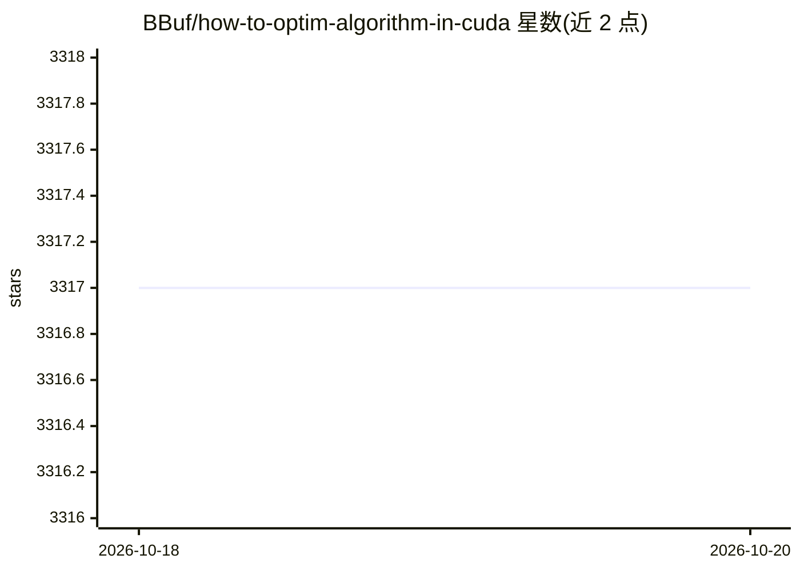

# BBuf/how-to-optim-algorithm-in-cuda

⭐ 3,317 · Cuda · 推送 2026-10-11 · [GitHub](https://github.com/BBuf/how-to-optim-algorithm-in-cuda) · 个人维护 · 中文 README

**CUDA/GPU 内核与 LLM 推理优化的学习笔记仓库**

个人维护的 GPU 系统工程学习笔记集合，内容涵盖手写 CUDA 内核（reduce/softmax/GEMV/线性注意力等）、CUDA-MODE 课程笔记、CUTLASS/CuTe DSL 笔记、Triton 内核与 PyTorch 互操作示例、PTX ISA 与 PyTorch internals 笔记，以及 LLM serving/训练优化材料和 GPU 架构论文笔记，按目录组织，另含小型辅助脚本与 deprecated 归档。面向学习 GPU 优化与 AI 基础设施的开发者与研究人员。

## 筛选速览

| 维度 | 判定 | 备注 |
|---|---|---|
| AI 角色 | `ai-knowledge` | 知识聚合/清单类 |
| 许可风险 | `none` | — |
| 部署形态 | `None` |  |
| 模型依赖 | — | README 未给出锁定关系 |
| 硬件要求 | — | 无带数字的原话,不猜 |
| 安装摩擦 | `medium` | 含编译或系统依赖之一 |
| 成熟度 | — | 结构信号不足 |

## 能力要点

- 手写 CUDA 内核覆盖 reduce、softmax、GEMV、线性注意力等算法
- CUTLASS/CuTe DSL、Triton、PTX ISA 多层次笔记
- LLM serving 与训练的系统优化笔记
- GPU 架构与 ML systems 论文笔记

## 适用场景

- 学习 CUDA 内核编写与优化技巧
- 查阅 CUTLASS/CuTe/Triton 的工程笔记
- 了解 LLM 推理与训练的系统优化方法

## 场景标签

`教程课程` · 领域:学习与行业

## 证据(README 行号)

> L3: CUDA, GPU kernel, and AI infrastructure optimization notes.
> L5: This repository collects hands-on CUDA kernels, CUTLASS/CuTe notes, Triton examples, PTX ISA notes, PyTorch internal

## 星数曲线

2026-10-18 3,317 → 2026-10-20 3,317（+0）

---
*卡片 v1 · prompt 1.4 · 生成 2026-10-20 · 置信度 high · 依据 README sha `42081dd0e0b5` · [字段定义](../../DATASET.md)*
