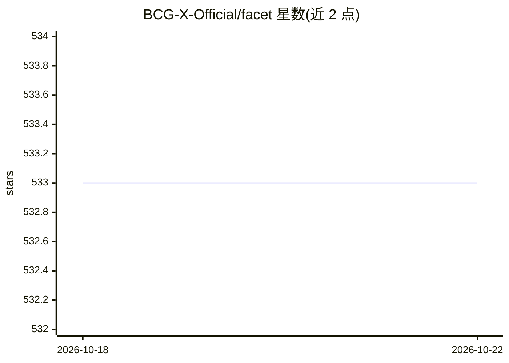

# BCG-X-Official/facet

⭐ 534 · Jupyter Notebook · Apache-2.0 · 推送 2026-02-10 · [GitHub](https://github.com/BCG-X-Official/facet) · [官网](https://bcg-x-official.github.io/facet) · 组织维护

**面向监督学习模型的人机可解释 AI 检验与模拟库**

由 BCG Gamma（BCG-X）维护的 Python 开源库，面向数据科学工作者，对 scikit-learn 监督学习模型提供可解释性分析。核心机制：模型检验算法量化特征两两间的协同（synergy）与冗余（redundancy），补充 SHAP 的局部视角（算法见 arXiv:2107.12436）；模型模拟用 ML 模型做虚拟实验以识别优化预测结果的场景，用平稳与分层 bootstrap 量化不确定性；增强工作流基于 sklearndf 提供 Sample、LearnerSelector 等模型选择组件，支持 pandas DataFrame 端到端特征追溯。经 PyPI 与 Anaconda 安装，支持 macOS/Linux/Windows。

## 筛选速览

| 维度 | 判定 | 备注 |
|---|---|---|
| AI 角色 | `ai-native` | 本体是模型或模型工具 |
| 许可风险 | `permissive` | Apache-2.0 |
| 部署形态 | `library` | 以包/库形式分发 |
| 模型依赖 | — | README 未给出锁定关系 |
| 硬件要求 | — | 无带数字的原话,不猜 |
| 安装摩擦 | `low` | 无编译、无系统依赖或容器化 |
| 成熟度 | — | 结构信号不足 |

## 能力要点

- 量化特征两两间协同与冗余的全局指标，补充 SHAP 局部解释
- 基于 bootstrap 的模型模拟虚拟实验，识别优化预测结果的场景
- LearnerSelector 比较超参数配置与多个学习器
- sklearndf 增强 scikit-learn，pandas DataFrame 端到端特征追溯

## 适用场景

- 分析监督模型中特征间的依赖与交互关系
- 通过虚拟实验寻找优化预测结果的输入场景
- 对多个学习器与超参数配置做选择与性能排名

## 场景标签

 · 领域:机器学习/可解释性

## 证据(README 行号)

> L3: FACET is an open source library for human-explainable AI.
> L12: ||inspect||FACET introduces a new algorithm to quantify dependencies and|
> L189: FACET enhances model inspection by providing global metrics that complement

## 星数曲线

2026-10-18 533 → 2026-10-22 533（+0）

---
*卡片 v1 · prompt 1.4 · 生成 2026-10-21 · 置信度 high · 依据 README sha `dc5df887eb2f` · [字段定义](../../DATASET.md)*
