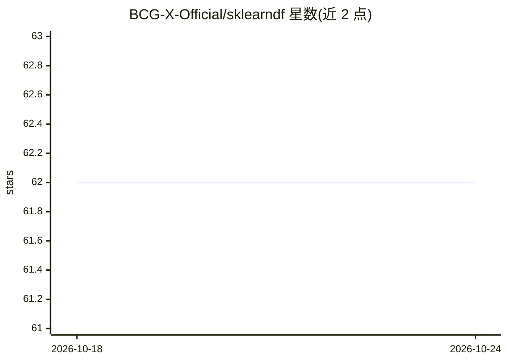

# BCG-X-Official/sklearndf

⭐ 62 · Python · Apache-2.0 · 推送 2026-02-10 · [GitHub](https://github.com/BCG-X-Official/sklearndf) · [官网](https://bcg-x-official.github.io/sklearndf/) · 组织维护

**让 scikit-learn 估计器保持 DataFrame 结构与特征名溯源的库**

sklearndf 是 BCG（BCG GAMMA）维护的开源 Python 库，封装 scikit-learn 的估计器：在类名后追加 DF 即可获得增强版本，使转换器输出保持 pandas DataFrame 结构并保留特征名，提供 feature_names_original_ 属性将输出特征列映射回原始输入特征，适用于 one-hot 编码等生成新特征的转换与流水线。同时提供 RegressorPipelineDF / ClassifierPipelineDF 两步专用流水线，predict 结果以 Series/DataFrame 返回。通过 PyPI 与 Anaconda 安装，支持 Python 3.9–3.13，Apache 2.0 许可。

## 筛选速览

| 维度 | 判定 | 备注 |
|---|---|---|
| AI 角色 | `ai-ecosystem` | LLM/agent 周边工具 |
| 许可风险 | `permissive` | Apache-2.0 |
| 部署形态 | `library` | 以包/库形式分发 |
| 模型依赖 | — | README 未给出锁定关系 |
| 硬件要求 | — | 无带数字的原话,不猜 |
| 安装摩擦 | `low` | 无编译、无系统依赖或容器化 |
| 成熟度 | — | 结构信号不足 |

## 能力要点

- scikit-learn 估计器的 DF 后缀增强版，保持 DataFrame 输出与特征名
- feature_names_original_ 属性实现输出特征到原始特征的溯源
- ClassifierPipelineDF / RegressorPipelineDF 两步专用流水线
- 支持 PyPI 与 Anaconda 安装，Python 3.9–3.13

## 适用场景

- 在预处理流水线中保留特征名以便检查模型
- 追踪 one-hot 编码等新生成特征回原始输入列
- 组合预处理与分类/回归步骤构建完整预测流水线

## 场景标签

 · 领域:机器学习工具库

## 证据(README 行号)

> L10: *sklearndf* is an open source library designed to address a common need with
> L16: To this end, *sklearndf* enhances scikit-learn's estimators as follows:

## 星数曲线

2026-10-18 62 → 2026-10-24 62（+0）

---
*卡片 v1 · prompt 1.4 · 生成 2026-10-24 · 置信度 high · 依据 README sha `ee4a127d816a` · [字段定义](../../DATASET.md)*
