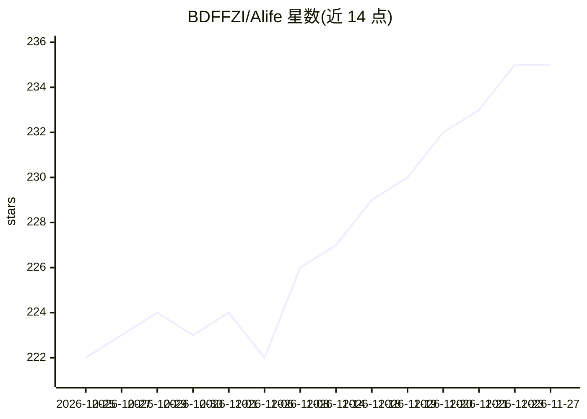

# BDFFZI/Alife

⭐ 235 · C# · AGPL-3.0 · 推送 2026-11-26 · [GitHub](https://github.com/BDFFZI/Alife) · 个人维护 · 中文 README

**桌面 AI 陪伴伙伴框架：以桌宠形式运行可成长的长期 Agent**

基于 .NET/C# 的桌宠向 AI Agent 框架，面向希望长期养育 AI 的用户。本体为纯框架，功能全部以插件实现，支持热编译热重载与 AI 自行编写插件；对话采用永久唯一会话与多级缓存的自动记忆压缩系统；函数调用为纯原生文本实现，不要求 LLM 具备特殊调用能力。提供 Windows 安装程序与 Android APK，运行时自动下载依赖（配国内镜像），数据明文存储并通过 MCP 对外暴露全量控制。

## 筛选速览

| 维度 | 判定 | 备注 |
|---|---|---|
| AI 角色 | `ai-native` | 本体是模型或模型工具 |
| 许可风险 | `viral` | AGPL-3.0 |
| 部署形态 | `None` |  |
| 模型依赖 | — | README 未给出锁定关系 |
| 硬件要求 | `gpu-8g` | |
| 安装摩擦 | `medium` | 含编译或系统依赖之一 |
| 成熟度 | `idea` | |

## 能力要点

- 全插件化架构，内置功能均为插件，支持热编译热重载
- 永久唯一会话与多级缓存式自动记忆压缩
- 纯原生文本函数调用，对 LLM 无特殊要求
- 框架 MCP 化，外部 Agent 可全自动控制与开发

## 适用场景

- 在桌面养一个能长期成长、有记忆的 AI 伙伴
- 通过插件市场自定义或让 AI 自行开发新功能
- 出门后经 QQ 等通讯平台继续与家中桌宠对话

## 场景标签

`AI 助手` · 领域:对话与助手

## 证据(README 行号)

> L32: Alife 是一款主打桌宠陪伴方向的 AIAgent，目的是为了创造或逼近一个真实赛博生命的效果，它不是功能特化，不是角色扮演，而是一切为了
> L37: - 极低词元开销：人工高度优化的提示词，专门设计过的上下文管理、注入系统、调用优化，非常省钱。
> L128: 1. 以最高扩展性设计框架：客户端本身甚至就是一具空壳，什么都没有，但等于什么都可以有。

## 星数曲线

2026-10-25 222 → 2026-11-27 235（+13）

---
*卡片 v1 · prompt 1.4 · 生成 2026-11-27 · 置信度 high · 依据 README sha `1da64e9b5db7` · [字段定义](../../DATASET.md)*
