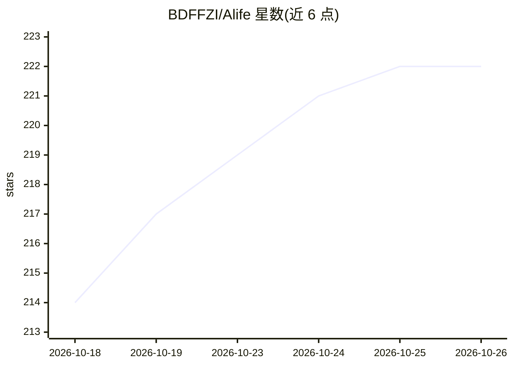

# BDFFZI/Alife

⭐ 222 · C# · AGPL-3.0 · 推送 2026-10-25 · [GitHub](https://github.com/BDFFZI/Alife) · 个人维护 · 中文 README

**桌宠陪伴向 AI Agent：桌面赛博生命框架**

基于 .NET/C# 的桌宠陪伴 AI Agent 桌面应用：以纯插件框架形态提供 live2D 桌宠交互、视觉识别、语音对话、长期记忆压缩、QQ/TG 通讯、自主上网、Python 脚本执行、游戏陪玩等功能，主张单一永久会话与极低词元开销（缓存命中 95%，官方 DeepSeek 日均不到 2 元，本地模型约 2G 显存）。框架已 MCP 化，外部 agent 可全量控制；数据明文存储，上下文全暴露。通过 Releases 压缩包安装，运行时自动下载依赖（全开约一小时）。AGPL-3.0 许可，目前仅限 PC 平台，跨平台为未来目标。

## 筛选速览

| 维度 | 判定 | 备注 |
|---|---|---|
| AI 角色 | `ai-native` | 本体是模型或模型工具 |
| 许可风险 | `viral` | AGPL-3.0 |
| 部署形态 | `None` |  |
| 模型依赖 | — | README 未给出锁定关系 |
| 硬件要求 | `gpu-8g` | |
| 安装摩擦 | `medium` | 含编译或系统依赖之一 |
| 成熟度 | `idea` | |

## 能力要点

- 全插件化架构，内置功能均为插件实现，支持热编译热重载与在线插件市场
- 框架自身 MCP 化（127.0.0.1:18765/mcp），允许外部 agent 或本体 AI 全量控制/自主开发插件
- 明文存储、上下文与执行过程完全暴露，记忆系统支持记录溯源搜索
- 内置本地模型优先，无第三方依赖与 key，自动装环境

## 适用场景

- 在桌面长期养育一个可成长的 AI 陪伴角色
- 通过 MCP 让外部 AI 编程 agent 全自动开发 Alife 插件
- 让 AI 通过视觉与语音陪玩游戏、聊天

## 场景标签

`Agent 框架` `AI 助手` · 领域:Agent 开发

## 证据(README 行号)

> L31: Alife 是一款主打桌宠陪伴方向的 AIAgent，目的是为了创造或逼近一个真实赛博生命的效果，它不是功能特化，不是角色扮演，而是一切为了
> L50: - 🎭 桌宠交互：通用桌宠交互框架，默认使用live2D，可完全自定义，具备丰富交互，告别枯燥的对话框。

## 星数曲线

2026-10-18 214 → 2026-10-26 222（+8）

---
*卡片 v1 · prompt 1.4 · 生成 2026-10-22 · 置信度 high · 依据 README sha `a8b1cc2d9294` · [字段定义](../../DATASET.md)*
