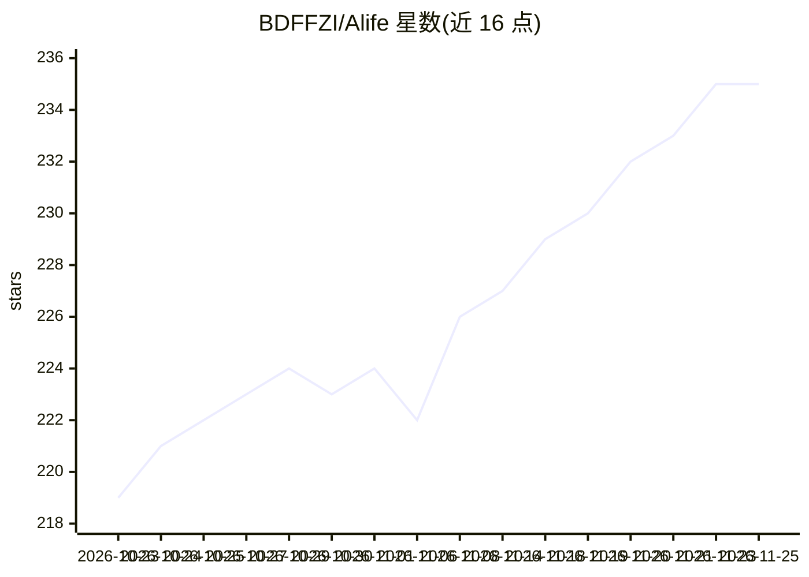

# BDFFZI/Alife

⭐ 235 · C# · AGPL-3.0 · 推送 2026-11-23 · [GitHub](https://github.com/BDFFZI/Alife) · 个人维护 · 中文 README

**面向想养 AI 的用户的桌宠 AI Agent 框架**

基于 .NET/C# 的全插件化桌宠 AI Agent，定位为陪伴向赛博生命而非角色扮演产品。客户端本体是空框架，对话、语音、视觉、记忆等内置功能均以插件实现，支持热编译热重载，AI 可自主编辑并重载插件。上下文采用分区复用与自动化记忆压缩，纯原生文本函数调用对 LLM 无特殊要求。提供 Windows 安装包与 Android APK，运行时自动下载依赖与本地模型。

## 筛选速览

| 维度 | 判定 | 备注 |
|---|---|---|
| AI 角色 | `ai-native` | 本体是模型或模型工具 |
| 许可风险 | `viral` | AGPL-3.0 |
| 部署形态 | `None` |  |
| 模型依赖 | — | README 未给出锁定关系 |
| 硬件要求 | `gpu-8g` | |
| 安装摩擦 | `medium` | 含编译或系统依赖之一 |
| 成熟度 | `idea` | |

## 能力要点

- 全插件框架：内置功能均为插件，支持热编译热重载与插件市场
- 纯原生文本函数调用，对 LLM 无特殊要求，缓存命中率与 token 开销低
- 永久唯一会话与基于多级 cache 思想的自动化记忆压缩系统
- 框架已 MCP 化，外部 Agent 可通过 alife-mcp 全量控制软件

## 适用场景

- 在桌面或手机上养一个可长期成长、有记忆的 AI 陪伴伙伴
- 通过插件为 AI 添加语音、视觉、游戏陪玩等自定义能力
- 让 AI Agent 通过 MCP 接口全自动开发 Alife 功能插件

## 场景标签

`Agent 框架` `AI 助手` · 领域:Agent 开发

## 证据(README 行号)

> L32: Alife 是一款主打桌宠陪伴方向的 AIAgent，目的是为了创造或逼近一个真实赛博生命的效果，它不是功能特化，不是角色扮演，而是一切为了
> L39: - 高度信息公开：明文存储数据，完全暴露上下文和AI执行过程，支持外部程序通过MCP全量控制。
> L63: - 🖼️ 原生多模态：原生支持图片、视频、文件等多种内容类型，图片复制粘贴即可发送，AI 可以"看见"世界。

## 星数曲线

2026-10-23 219 → 2026-11-25 235（+16）

---
*卡片 v1 · prompt 1.4 · 生成 2026-11-25 · 置信度 high · 依据 README sha `97eb9c84a763` · [字段定义](../../DATASET.md)*
