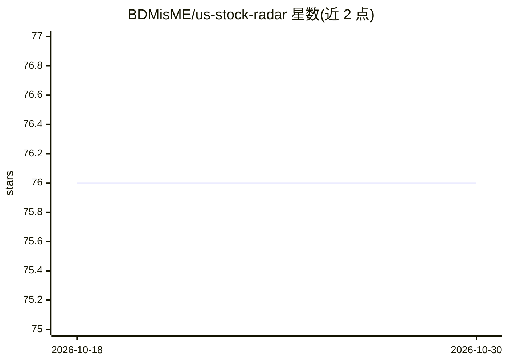

# BDMisME/us-stock-radar

⭐ 76 · Python · MIT · 推送 2026-06-21 · [GitHub](https://github.com/BDMisME/us-stock-radar) · 个人维护 · 中文 README

**个人美股 AI 看盘雷达：规则引擎+常驻 LLM 分析师自架监控**

自架的个人美股监控与投研 Streamlit 仪表盘：通过 Alpaca IEX WebSocket 订阅即时报价（上限 30 档）、自算 MA/RSI/MACD 等技术指标，规则引擎将 tick 压缩为 15 种事件，再由常驻 AI 分析师（任意 OpenAI 相容 LLM）生成结构化研究并经 Telegram/Email 通知；各常驻进程以 SQLite（WAL）作事件队列，无需 Redis/Kafka。所有 API key 选填、缺 key 优雅降级。不自动下单、不接券商交易 API；单用户设计、无登录权限机制。本地 venv 多终端或 Docker 一键启动，另支持 Zeabur 部署。

## 筛选速览

| 维度 | 判定 | 备注 |
|---|---|---|
| AI 角色 | `ai-enhanced` | 去掉 AI 部分产品仍成立 |
| 许可风险 | `permissive` | MIT |
| 部署形态 | `self-host` | docker 或自建部署 |
| 模型依赖 | — | README 未给出锁定关系 |
| 硬件要求 | — | 无带数字的原话,不猜 |
| 安装摩擦 | `low` | 无编译、无系统依赖或容器化 |
| 成熟度 | — | 结构信号不足 |

## 能力要点

- 规则引擎压缩 tick 为事件后交 LLM 分析，LLM 不直接读逐秒报价
- 15 种规则事件 + 分层冷却（短线 2h / 长期 4h）控制分析频率
- Finnhub → FMP → yfinance 链式备援轮询
- SQLite WAL 模式作事件队列，无需 Redis/Kafka

## 适用场景

- 自架一个监控持股与观察名单的个人看盘面板
- 让 AI 对异常事件生成结构化研究并推送到 Telegram
- 休市或盘后仍查看前一日收盘与指标

## 场景标签

`金融量化` · 领域:学习与行业

## 证据(README 行号)

> L5: 個人用「美股 AI 看盤雷達」。監控**持股 / 高關注 / 一般觀察名單**，自算技術指標、用規則引擎偵測異常事件，由常駐 AI 分析師（**任何 OpenAI 相容 LLM**）主動產生**結構化研究與風險提醒**，並透過 Em
> L29: |AI 分析師|常駐讀取事件 queue，呼叫 LLM 產生結構化 JSON；分層**冷卻**（短線 2h / 長期・高關注 4h）避免雜訊|

## 星数曲线

2026-10-18 76 → 2026-10-30 76（+0）

---
*卡片 v1 · prompt 1.4 · 生成 2026-10-24 · 置信度 high · 依据 README sha `540e5580ee74` · [字段定义](../../DATASET.md)*
