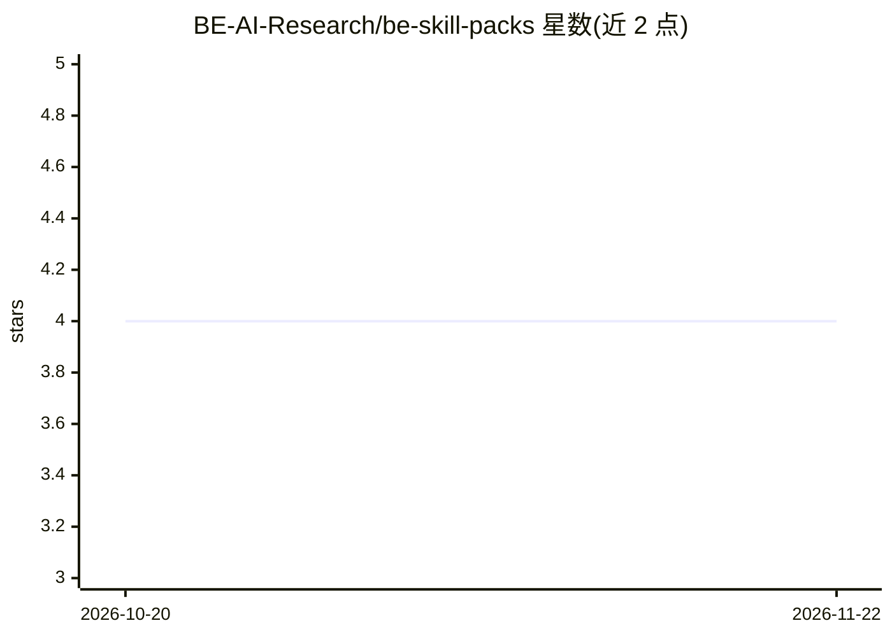

# BE-AI-Research/be-skill-packs

⭐ 4 · JavaScript · MIT · 推送 2026-10-30 · [GitHub](https://github.com/BE-AI-Research/be-skill-packs) · 组织维护

**为 coding agent 提供领域知识包的 Markdown/JSON 文件集合**

以 Markdown 和 JSON 文件夹形式为 agentic coding 工具提供领域知识：每个 pack 包含常驻规则（有 token 上限）、按需获取的知识块、验证命令和错误 playbook（失败原因→修复→备选方案）。Pack 本身不执行代码，只命名命令与解析器。需 BE-Code 1.3.0+ 的 packs 命令安装；其他 harness 可按 docs/PACK-FORMAT.md 契约实现加载。覆盖 bash/zsh/pwsh/UE5/React+TypeScript/逆向工程/CAD 等领域，多数 pack 处于 0.1.0 早期状态。

## 筛选速览

| 维度 | 判定 | 备注 |
|---|---|---|
| AI 角色 | `ai-knowledge` | 知识聚合/清单类 |
| 许可风险 | `permissive` | MIT |
| 部署形态 | `None` |  |
| 模型依赖 | — | README 未给出锁定关系 |
| 硬件要求 | — | 无带数字的原话,不猜 |
| 安装摩擦 | `low` | 无编译、无系统依赖或容器化 |
| 成熟度 | `idea` | |

## 能力要点

- 每个 pack 含常驻规则、按需知识块、验证命令与错误 playbook 四部分
- pack 为纯文件，加载不执行第三方代码
- 提供 PACK-FORMAT.md 格式契约供其他 harness 实现
- docs/ledgers 记录编写过程中的错误与修正

## 适用场景

- 让 coding agent 处理它不熟悉的 UE5 C++ 或 zsh 技术栈
- 按 playbook 逐步排查构建失败等工具链错误
- 为自己的 harness 编写并校验 pack（validate 命令）

## 场景标签

`编码 Agent` `提示工程` · 领域:Agent 开发

## 证据(README 行号)

> L5: Domain expertise for agentic coding harnesses, as folders of Markdown and JSON.
> L9: set of knowledge chunks the model fetches by name when it needs them, the
> L25: |Pack|What it knows|State|

## 星数曲线

2026-10-20 4 → 2026-11-22 4（+0）

---
*卡片 v1 · prompt 1.4 · 生成 2026-11-21 · 置信度 high · 依据 README sha `950bf83eab43` · [字段定义](../../DATASET.md)*
