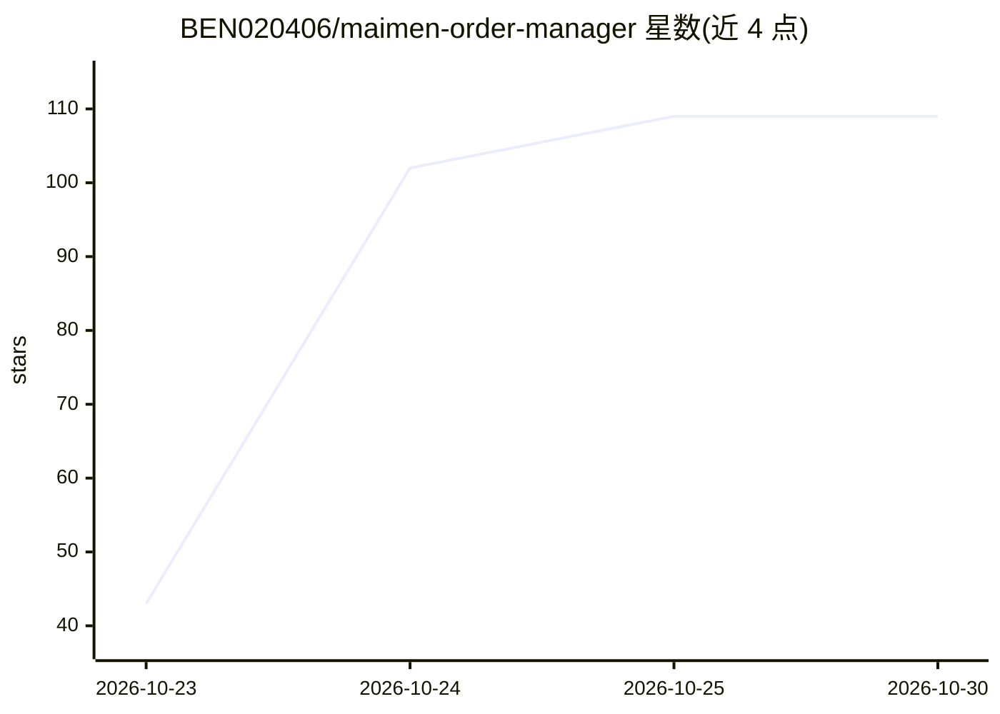

# BEN020406/maimen-order-manager

⭐ 109 · Python · 推送 2026-10-22 · [GitHub](https://github.com/BEN020406/maimen-order-manager) · [官网](https://ben020406.github.io/maimen-order-manager/) · 个人维护 · 中文 README

**麦当劳订单权益管理技能：理清待评价、兑礼与发票凑单**

面向麦当劳高频用户的个人效率工具，以 WorkBuddy 桌面端技能形式运行，通过麦当劳 MCP 接口（open.mcd.cn/mcp Token）拉取订单数据，输出待评价清单、好评兑礼进度、发票报销门槛凑单组合与积分抽奖信息。另提供独立 CLI 与静态页面演示。设计上只整理不代办：抽奖前出预览卡需确认，代下单/代评价/代提交发票不在范围内。已知限制包括接口无评价字段（需手动标记）、仅覆盖最近 10 笔订单、标记仅存本机浏览器。99 项单元测试。

## 筛选速览

| 维度 | 判定 | 备注 |
|---|---|---|
| AI 角色 | `ai-ecosystem` | LLM/agent 周边工具 |
| 许可风险 | `none` | — |
| 部署形态 | `None` |  |
| 模型依赖 | — | README 未给出锁定关系 |
| 硬件要求 | — | 无带数字的原话,不猜 |
| 安装摩擦 | `low` | 无编译、无系统依赖或容器化 |
| 成熟度 | — | 结构信号不足 |

## 能力要点

- 通过麦当劳 MCP 接口聚合订单状态，输出可执行结论
- 发票报销门槛凑单：挑选最少组合并报超出额
- 抽奖前展示消耗，用户确认后才执行一次
- 提供 CLI 可脱离界面单独运行，99 项测试

## 适用场景

- 算清还差几条好评能兑换小食
- 按公司报销门槛凑齐满 100/50 元的发票组合
- 查看剩余积分与抽奖活动再决定是否抽奖

## 场景标签

`AI 助手` · 领域:对话与助手

## 证据(README 行号)

> L50: 1. WorkBuddy 桌面端（技能运行在本地，依赖本机 Python 与连接器配置）
> L65: WorkBuddy → 左侧「专家 · 技能 · 连接器」→「连接器」→ 右上角「自定义连接器」→「配置 MCP」：
> L90: 在 WorkBuddy 对话里直接说：

## 星数曲线

2026-10-23 43 → 2026-10-30 109（+66）

---
*卡片 v1 · prompt 1.4 · 生成 2026-10-23 · 置信度 high · 依据 README sha `5664baf5567f` · [字段定义](../../DATASET.md)*
