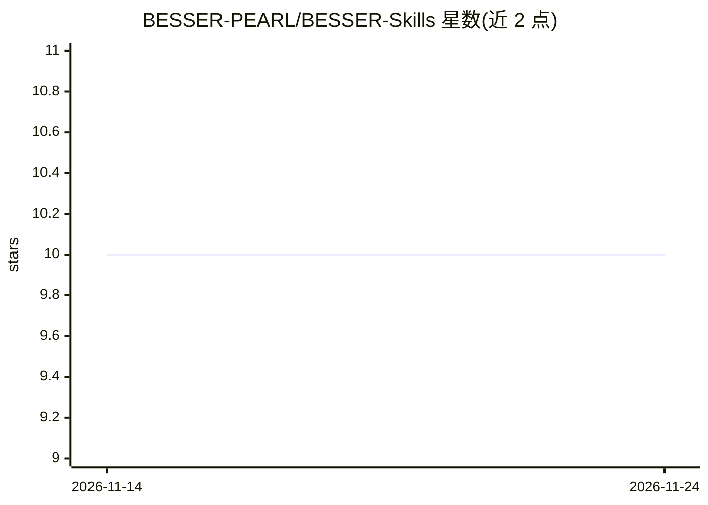

# BESSER-PEARL/BESSER-Skills

⭐ 10 · Python · Apache-2.0 · 推送 2026-10-20 · [GitHub](https://github.com/BESSER-PEARL/BESSER-Skills) · [官网](https://besser.readthedocs.io) · 组织维护

**给 AI 编程代理注入 BESSER 建模知识的技能包**

BESSER 低代码平台的 Agent Skills 集合，包含 besser-user、besser-generators、besser-troubleshooting、besser-dev 四个技能，为支持 Agent Skills 标准的编程代理提供 B-UML 元模型、19 个代码生成器、故障诊断与贡献者流程知识。代理启动时仅加载技能名称与描述，任务匹配时才读入完整 SKILL.md。安装方式包括 skills CLI（npx）、Claude Code 插件与手动复制目录；自述在 8 个评测场景下与基线正确率相同且耗时/令牌更低。

## 筛选速览

| 维度 | 判定 | 备注 |
|---|---|---|
| AI 角色 | `ai-knowledge` | 知识聚合/清单类 |
| 许可风险 | `permissive` | Apache-2.0 |
| 部署形态 | `library` | 以包/库形式分发 |
| 模型依赖 | — | README 未给出锁定关系 |
| 硬件要求 | — | 无带数字的原话,不猜 |
| 安装摩擦 | `low` | 无编译、无系统依赖或容器化 |
| 成熟度 | — | 结构信号不足 |

## 能力要点

- 四个技能覆盖建模、19 个生成器、故障诊断与贡献流程
- 遵循 Agent Skills 开放标准，兼容 Claude Code、Cursor 等 40+ 代理
- 基于渐进式披露：启动仅载名称与描述，匹配任务才读全文
- 附带 8 场景 with-skill/without-skill 基准评测数据

## 适用场景

- 让编程代理按 B-UML 正确构建 UML 类模型并生成代码
- 在 Markdown 文档中嵌入可运行、可验证的 UML 结构图
- 排查 BESSER 的安装、导入、运行与部署报错
- 为 BESSER 平台贡献生成器、测试与文档

## 场景标签

`代码生成` · 领域:编码与开发

## 证据(README 行号)

> L11: Agent Skills for BESSER, the low-code model-driven engineering platform. These skills give AI coding agents deep kn
> L125: Skills follow the Agent Skills open standard. The agent loads only the skill name and description at startup (a fe

## 星数曲线

2026-11-14 10 → 2026-11-24 10（+0）

---
*卡片 v1 · prompt 1.4 · 生成 2026-11-20 · 置信度 high · 依据 README sha `96846222a00f` · [字段定义](../../DATASET.md)*
