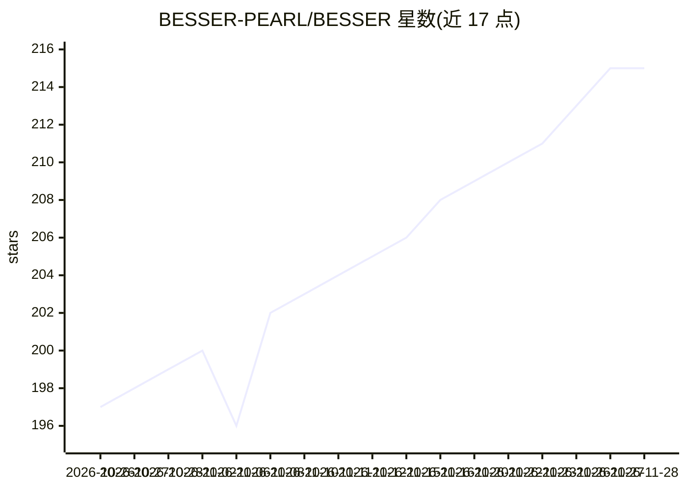

# BESSER-PEARL/BESSER

⭐ 215 · Python · MIT · 推送 2026-11-26 · [GitHub](https://github.com/BESSER-PEARL/BESSER) · [官网](https://besser.readthedocs.io/en/latest/) · 组织维护

**模型驱动的低代码平台：画 UML 模型生成全栈应用**

BESSER 是用 Python 实现的开源模型驱动低代码平台：用户在浏览器编辑器绘制 UML/B-UML 模型或用文字描述应用，由确定性代码生成器产出 FastAPI、React、Django、Spring Boot、Flutter、SQL DDL、Docker Compose 等代码；模板未覆盖的部分（如 auth、测试）由实验性 Spec-Driven Agent 调用 LLM 补全并验证。可经 Web 编辑器免安装使用、pip 安装为 Python 库，或通过 Agent Skills 由 AI 编码代理调用。模型作为唯一事实来源，可反复重新生成。FNR Pearl 资助，卢森堡科学技术研究所等机构维护。

## 筛选速览

| 维度 | 判定 | 备注 |
|---|---|---|
| AI 角色 | `ai-native` | 本体是模型或模型工具 |
| 许可风险 | `permissive` | MIT |
| 部署形态 | `self-host` | docker 或自建部署 |
| 模型依赖 | — | README 未给出锁定关系 |
| 硬件要求 | — | 无带数字的原话,不猜 |
| 安装摩擦 | `low` | 无编译、无系统依赖或容器化 |
| 成熟度 | — | 结构信号不足 |

## 能力要点

- 从同一模型确定性生成 FastAPI/React/Django/Spring Boot/Flutter/SQL 等多栈代码
- Spec-Driven Agent 在生成脚手架基础上用 LLM 补全 auth、Docker、测试等并验证结果
- 支持 Web 编辑器免安装使用，或通过 npx 安装 Agent Skills 供 Claude Code/Cursor 等调用
- 模型可含类、对象、状态机、Agent、GUI、BPMN、神经网络与量子模型

## 适用场景

- 用类图快速生成带数据库和 CRUD 端点的 REST API
- 让 AI 编码代理按描述建模并生成 FastAPI 后端
- 从模型一键生成全栈 Web 应用与部署配置

## 场景标签

`代码生成` · 领域:编码与开发

## 证据(README 行号)

> L5:  BESSER is an open-source, model-driven low-code platform in Python.
> L65: - **AI where templates stop.** The experimental Spec-Driven Agent starts from the generated scaffold, lets an LLM a

## 星数曲线

2026-10-26 197 → 2026-11-28 215（+18）

---
*卡片 v1 · prompt 1.4 · 生成 2026-11-25 · 置信度 mid · 依据 README sha `8b696e443b93` · [字段定义](../../DATASET.md)*
