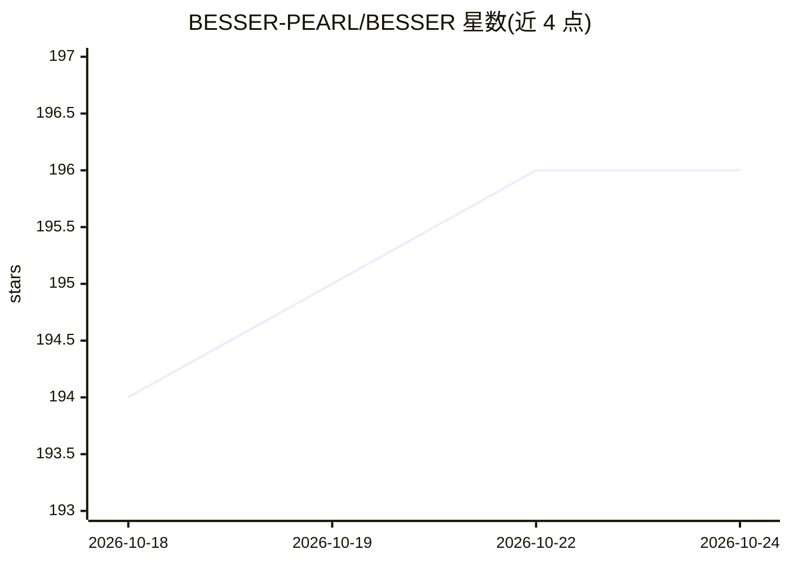

# BESSER-PEARL/BESSER

⭐ 196 · Python · MIT · 推送 2026-10-23 · [GitHub](https://github.com/BESSER-PEARL/BESSER) · [官网](https://besser.readthedocs.io/en/latest/) · 组织维护

**画 UML 模型即生成全栈应用的低代码平台**

Python 实现的开源模型驱动低代码平台：在浏览器编辑器或 Python 代码中定义 UML/B-UML 模型，由确定性代码生成器产出 FastAPI、React、Django、Spring Boot、Flutter、SQL、Docker 等代码；实验性 Spec-Driven Agent 在模板生成的脚手架之上由 LLM 补充模板未覆盖部分（认证、测试等）并校验结果，配置免费档时可无需 API key 运行。另以 Agent Skills 形式打包，供 Claude Code、Cursor、Copilot、Cline 等编码 agent 调用。由 LIST 与卢森堡大学基于 FNR Pearl 资助维护。

## 筛选速览

| 维度 | 判定 | 备注 |
|---|---|---|
| AI 角色 | `ai-enhanced` | 去掉 AI 部分产品仍成立 |
| 许可风险 | `permissive` | MIT |
| 部署形态 | `self-host` | docker 或自建部署 |
| 模型依赖 | — | README 未给出锁定关系 |
| 硬件要求 | — | 无带数字的原话,不猜 |
| 安装摩擦 | `low` | 无编译、无系统依赖或容器化 |
| 成熟度 | `idea` | |

## 能力要点

- 同一模型确定性生成 FastAPI/React/Django/Spring Boot/Flutter/SQL 等代码
- 实验性 Spec-Driven Agent：模板脚手架 + LLM 补充生成并校验
- BESSER Skills 供 Claude Code/Cursor/Copilot/Cline 等 AI 编码 agent 使用
- 浏览器编辑器免安装，或 pip install besser 以 Python API 使用

## 适用场景

- 画一个类图就得到带数据库和 CRUD 的 REST API
- 在 AI 编码助手中用自然语言建模并生成后端
- 用模型作为唯一事实来源，改模型后重新生成代码

## 场景标签

`代码生成` · 领域:编码与开发

## 证据(README 行号)

> L5:  BESSER is an open-source, model-driven low-code platform in Python.
> L64: - **Deterministic.** The same model always produces the same code. No prompt roulette for the parts that should be 
> L65: - **AI where templates stop.** The experimental Spec-Driven Agent starts from the generated scaffold, lets an LLM a

## 星数曲线

2026-10-18 194 → 2026-10-24 196（+2）

---
*卡片 v1 · prompt 1.4 · 生成 2026-10-22 · 置信度 mid · 依据 README sha `a95e9a3386a4` · [字段定义](../../DATASET.md)*
