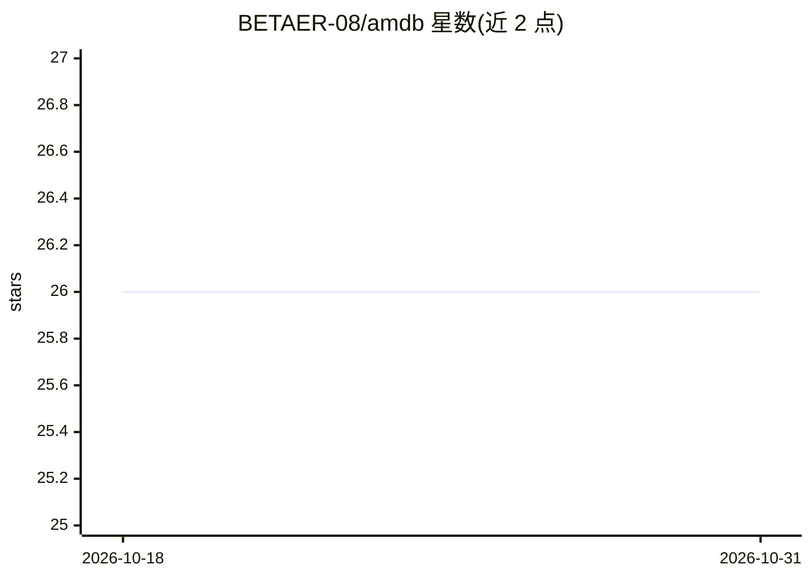

# BETAER-08/amdb

⭐ 26 · Rust · MIT · 推送 2026-07-25 · [GitHub](https://github.com/BETAER-08/amdb) · 个人维护

**把代码库转成 AI 上下文本地 MCP 服务器：AST+调用图+向量检索**

单二进制 Rust 写就的代码上下文 MCP 服务器，零 Node/Python 运行时依赖。amdb init 用 Tree-sitter 做 AST 解析、提取符号与调用边并用本地 fastembed 模型生成嵌入，全部存入本地 SQLite；通过 MCP stdio 暴露三个检索工具（项目概览、聚焦查询、符号定义与调用者/被调用者），也可生成 Markdown 上下文文件。面向隔离网络、CI 容器等禁止云端索引代码的场景。支持 16 种语法的符号与调用图提取，其中仅 Rust/Python/TypeScript 提供 AST 精确的可见性与签名。

## 筛选速览

| 维度 | 判定 | 备注 |
|---|---|---|
| AI 角色 | `ai-ecosystem` | LLM/agent 周边工具 |
| 许可风险 | `permissive` | MIT |
| 部署形态 | `desktop` | 安装包/桌面程序 |
| 模型依赖 | — | README 未给出锁定关系 |
| 硬件要求 | — | 无带数字的原话,不猜 |
| 安装摩擦 | `low` | 无编译、无系统依赖或容器化 |
| 成熟度 | — | 结构信号不足 |

## 能力要点

- 单二进制、无 Node/Python 运行时，代码不离开本机
- Tree-sitter AST 解析 + 本地嵌入 + 调用图扩展的组合检索
- 16 种语法的符号与调用图提取（3 种有 AST 精确签名）
- daemon 模式保存时增量重建索引，另提供 Docker 镜像

## 适用场景

- 在隔离网络/受监管环境中为 AI 编辑器提供代码上下文
- 让 coding agent 通过 MCP 按查询聚焦检索代码库而非整库喂入
- 生成面向特定主题（如 auth）的 Markdown 上下文文件

## 场景标签

`语义搜索` · 领域:知识与检索

## 证据(README 行号)

> L12: amdb is a zero-runtime, single-binary code context MCP server with combined graph + vector retrieval. No code leave
> L26: amdb serve     # expose the index as an MCP server over stdio

## 星数曲线

2026-10-18 26 → 2026-10-31 26（+0）

---
*卡片 v1 · prompt 1.4 · 生成 2026-10-26 · 置信度 high · 依据 README sha `f7fab8f644fa` · [字段定义](../../DATASET.md)*
