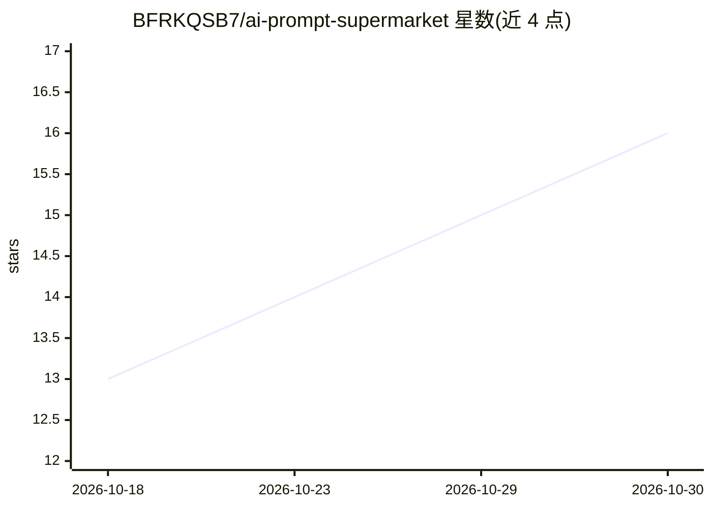

# BFRKQSB7/ai-prompt-supermarket

⭐ 16 · HTML · MIT · 推送 2026-08-16 · [GitHub](https://github.com/BFRKQSB7/ai-prompt-supermarket) · [官网](https://bfrkqsb7.github.io/ai-prompt-supermarket/) · 个人维护 · 中文 README

**本地离线 AI 绘画提示词生成工具：点选中文标签生成英文提示词**

单文件 HTML 网页工具，面向 Stable Diffusion 系标签型模型（NoobAI-XL / Illustrious / Pony Diffusion 等）的使用者：内置 31.7 万条 Danbooru 中英对照标签，按发色、服装、场景、NSFW 等分类组织，用户点选中文标签后自动拼装英文提示词，可一键复制正面/负面内容。零依赖、双击 index.html 即用，数据全内联离线可用（约 14MB），另提供 GitHub Pages 在线版。支持搜索、收藏、导入导出、提示词回填识别与权重编辑。限制：文件较大首次加载需等待；自动保存功能需 Chrome/Edge。

## 筛选速览

| 维度 | 判定 | 备注 |
|---|---|---|
| AI 角色 | `ai-ecosystem` | LLM/agent 周边工具 |
| 许可风险 | `permissive` | MIT |
| 部署形态 | `None` |  |
| 模型依赖 | — | README 未给出锁定关系 |
| 硬件要求 | — | 无带数字的原话,不猜 |
| 安装摩擦 | `low` | 无编译、无系统依赖或容器化 |
| 成熟度 | — | 结构信号不足 |

## 能力要点

- 内置 317,423 条 Danbooru 中英对照标签，分类+二级分类组织
- 单文件 HTML、零依赖、数据内联离线可用
- 提示词回填识别：粘贴已有提示词自动还原为中文胶囊并识别权重
- 收藏/预设/导入导出 JSON，跨会话持久化

## 适用场景

- 为 Stable Diffusion 标签型模型手动挑选精细提示词
- 离线或在线浏览 Danbooru 标签库并收藏常用词
- 粘贴已有提示词回填识别、调整权重与顺序后复用

## 场景标签

`提示工程` · 领域:Agent 开发

## 证据(README 行号)

> L5: 本地离线的 AI 绘画提示词生成工具：**点选中文标签，自动生成英文提示词**。单文件、零依赖、双击即用。
> L38: Stable Diffusion 系标签型模型：**NoobAI-XL / Illustrious / Manhwa Style / Pony Diffusion** 等（Danbooru 标签体系）。

## 星数曲线

2026-10-18 13 → 2026-10-30 16（+3）

---
*卡片 v1 · prompt 1.4 · 生成 2026-10-30 · 置信度 high · 依据 README sha `7226dbe9260a` · [字段定义](../../DATASET.md)*
