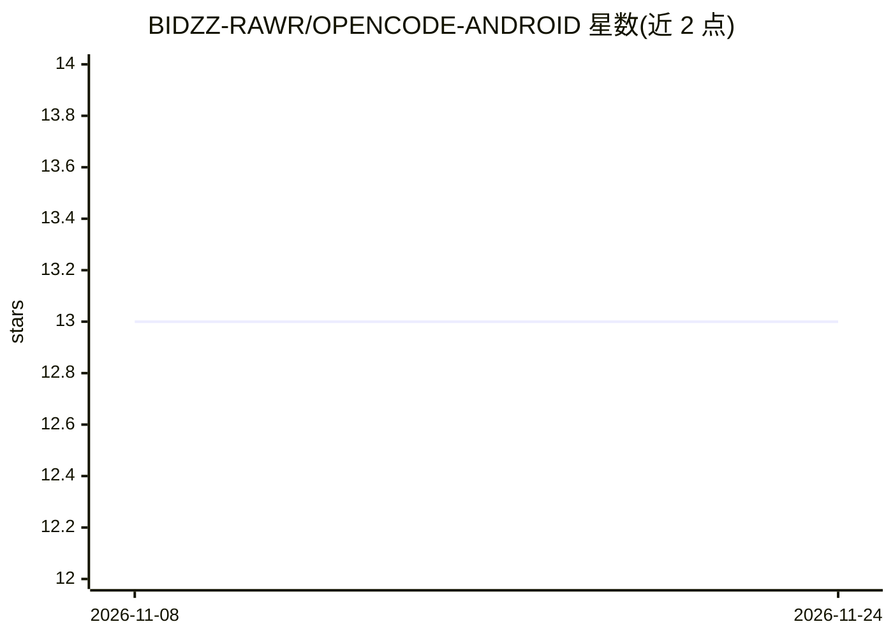

# BIDZZ-RAWR/OPENCODE-ANDROID

⭐ 13 · Kotlin · MIT · 推送 2026-11-17 · [GitHub](https://github.com/BIDZZ-RAWR/OPENCODE-ANDROID) · 个人维护

**在 Android 手机上本地运行 OpenCode 编码 agent 的应用**

将上游 OpenCode（TypeScript/Bun 服务器）交叉编译为 Android 原生二进制，作为子进程在应用内运行，外包一层 Jetpack Compose 界面。引擎仅监听 127.0.0.1，网络流量仅发往用户配置的模型 provider。功能包括流式对话、工具调用时间线、权限审批卡片、项目文件浏览与 git diff、内置 git 与 ripgrep，前台服务保持引擎存活。独立项目，非 OpenCode 官方出品，不支持 MCP、交互终端、https git 等功能，需 Android 10+ 与约 350 MB 空间。

## 筛选速览

| 维度 | 判定 | 备注 |
|---|---|---|
| AI 角色 | `ai-native` | 本体是模型或模型工具 |
| 许可风险 | `permissive` | MIT |
| 部署形态 | `None` |  |
| 模型依赖 | — | README 未给出锁定关系 |
| 硬件要求 | — | 无带数字的原话,不猜 |
| 安装摩擦 | `low` | 无编译、无系统依赖或容器化 |
| 成熟度 | — | 结构信号不足 |

## 能力要点

- 上游 OpenCode v2.2.2 引擎经 Bun 交叉编译后以内置子进程方式运行
- 流式回复、工具调用时间线与 Allow/Reject 权限审批
- 内置 git 2.56.0 与 ripgrep 15.1.0（NDK 构建、16 KB 对齐）
- 支持内置 provider API key 或自定义 OpenAI 兼容端点

## 适用场景

- 在手机上直接对真实项目文件夹运行编码 agent
- 在无桌面环境时审查和编辑代码并查看 git diff
- 用自选 API key 或 OpenAI 兼容端点接入模型服务

## 场景标签

`编码 Agent` · 领域:编码与开发

## 证据(README 行号)

> L25: OpenCode is an open source AI coding agent: you describe a task, it reads your project, runs
> L26: tools, edits files, and reports back. This project runs **the actual upstream engine** (the
> L27: TypeScript/Bun server) as a child process inside the Android app, and wraps it in a native
> L40: |**Bring your own provider**|Add an API key for a built-in provider, or define a custom OpenAI-compatible endpoint 

## 星数曲线

2026-11-08 13 → 2026-11-24 13（+0）

---
*卡片 v1 · prompt 1.4 · 生成 2026-11-18 · 置信度 high · 依据 README sha `f0cbdb0a75b1` · [字段定义](../../DATASET.md)*
