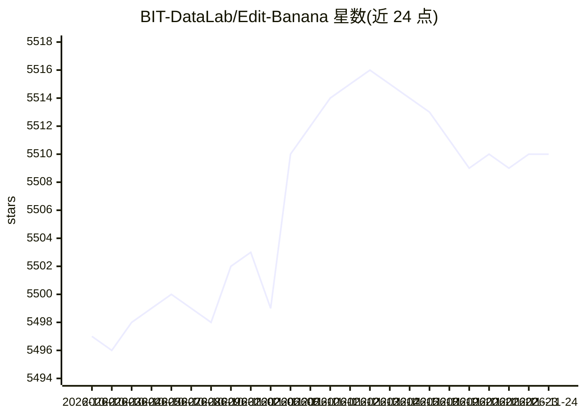

# BIT-DataLab/Edit-Banana

⭐ 5,510 · Python · AGPL-3.0 · 推送 2026-11-20 · [GitHub](https://github.com/BIT-DataLab/Edit-Banana) · [官网](https://www.editbanana.net) · 组织维护 · 中文 README

**把静态图表图像转换为可编辑 DrawIO 文件的工具**

读取 PNG/JPG/BMP/TIFF/WebP 等图像格式的图表，经微调的 SAM 3 分割图元、本地 OCR 与 Pix2Text 提取文字与公式、结合多模态 LLM 扫描，生成可编辑的 DrawIO XML，保留原图布局、配色与元素层级。提供 CLI 与本地 Web API 两种使用方式，另有在线演示站点（README 注明仓库功能落后于网页版）。内置用户注册与按次计费的积分机制、全局锁与 LRU 缓存支持多用户并发。需 Python 3.10+，推荐 CUDA GPU，CPU 亦可运行。

## 筛选速览

| 维度 | 判定 | 备注 |
|---|---|---|
| AI 角色 | `ai-native` | 本体是模型或模型工具 |
| 许可风险 | `dual` | AGPL-3.0 |
| 部署形态 | `library` | 以包/库形式分发 |
| 模型依赖 | — | README 未给出锁定关系 |
| 硬件要求 | — | 无带数字的原话,不猜 |
| 安装摩擦 | `medium` | 含编译或系统依赖之一 |
| 成熟度 | `idea` | |

## 能力要点

- 微调 SAM 3 做图表元素分割，生成 DrawIO XML
- 本地 OCR（Tesseract/PaddleOCR）+ Pix2Text 公式转 LaTeX
- CLI 批处理与本地 FastAPI 风格 Web API 两种入口
- 全局锁 + LRU 缓存支持多用户并发访问

## 适用场景

- 把论文或报告里的流程图截图变成可编辑的 DrawIO 文件
- 批量将历史图表图片转换为可修改的矢量元素
- 修改他人图片中的架构图内容

## 场景标签

`文档解析` · 领域:知识与检索

## 证据(README 行号)

> L10: Powered by SAM 3 and multimodal large models, it enables high-fidelity reconstruction that preserves the original d
> L104: - **Advanced Segmentation**: Using our fine-tuned **SAM 3 (Segment Anything Model 3)** for segmentation of diagram
> L119: 1. **Input**: Image (PNG/JPG/BMP/TIFF/WebP).

## 星数曲线

2026-10-22 5,497 → 2026-11-24 5,510（+13）

---
*卡片 v1 · prompt 1.4 · 生成 2026-11-22 · 置信度 high · 依据 README sha `b693baf457f1` · [字段定义](../../DATASET.md)*
