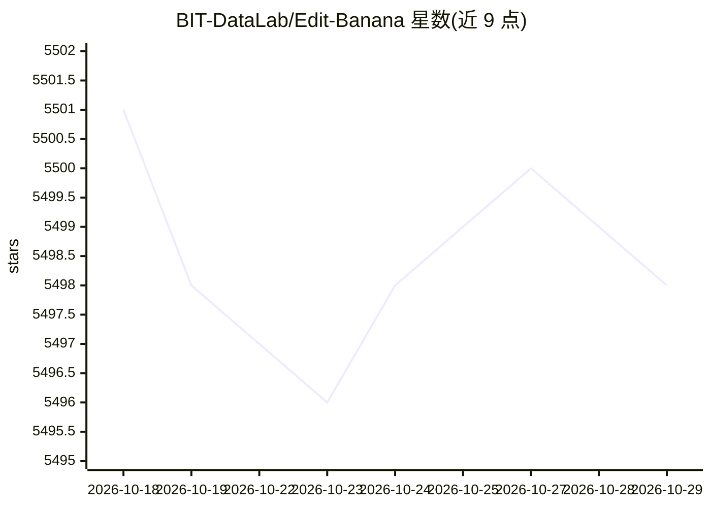

# BIT-DataLab/Edit-Banana

⭐ 5,498 · Python · AGPL-3.0 · 推送 2026-10-27 · [GitHub](https://github.com/BIT-DataLab/Edit-Banana) · [官网](https://www.editbanana.net) · 组织维护 · 中文 README

**将静态图表图片转换为可编辑 DrawIO XML 的框架**

面向需要编辑流程图、架构图、示意图等静态图片的用户：上传 PNG/JPG/BMP/TIFF/WebP 图片，经微调的 SAM 3 分割、本地 OCR（Tesseract 或 PaddleOCR）与 Pix2Text 公式识别、多模态 LLM 引导的扫描流程，生成可在 DrawIO 中编辑的 XML，元素可单独拖拽与改样式。提供 CLI 批量/单图处理与 FastAPI 风格的 web API，另有在线服务；本地部署需 Python 3.10+、下载 SAM3 权重并安装 Tesseract，CUDA GPU 为推荐配置。路线图中箭头智能连接、本地 VLM 部署等仍在开发/规划中。

## 筛选速览

| 维度 | 判定 | 备注 |
|---|---|---|
| AI 角色 | `ai-native` | 本体是模型或模型工具 |
| 许可风险 | `dual` | AGPL-3.0 |
| 部署形态 | `library` | 以包/库形式分发 |
| 模型依赖 | — | README 未给出锁定关系 |
| 硬件要求 | — | 无带数字的原话,不猜 |
| 安装摩擦 | `medium` | 含编译或系统依赖之一 |
| 成熟度 | — | 结构信号不足 |

## 能力要点

- SAM 3 微调模型做图表元素分割
- 本地 OCR（Tesseract/PaddleOCR）+ Pix2Text 公式转 LaTeX
- 输出可直接编辑的 DrawIO XML，元素独立可选可改
- 提供 CLI、web API（/convert 端点）与在线演示

## 适用场景

- 把论文或文档中的流程图转成 DrawIO 再编辑排版
- 批量将静态架构图转为可维护的矢量图源文件
- 识别并重建含数学公式的技术示意图

## 场景标签

`文档解析` · 领域:知识与检索

## 证据(README 行号)

> L10: Powered by SAM 3 and multimodal large models, it enables high-fidelity reconstruction that preserves the original d
> L104: - **Advanced Segmentation**: Using our fine-tuned **SAM 3 (Segment Anything Model 3)** for segmentation of diagram
> L119: 1. **Input**: Image (PNG/JPG/BMP/TIFF/WebP).

## 星数曲线

2026-10-18 5,501 → 2026-10-29 5,498（-3）

---
*卡片 v1 · prompt 1.4 · 生成 2026-10-20 · 置信度 mid · 依据 README sha `28194e05d030` · [字段定义](../../DATASET.md)*
