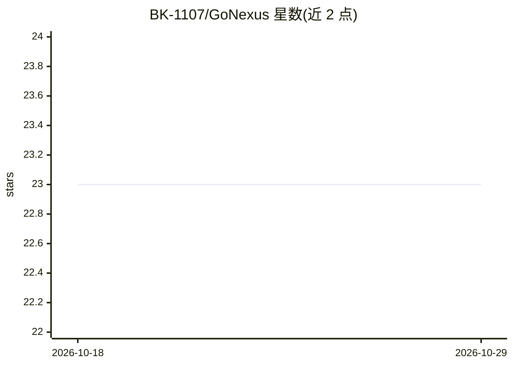

# BK-1107/GoNexus

⭐ 23 · Go · GPL-3.0 · 推送 2026-08-05 · [GitHub](https://github.com/BK-1107/GoNexus) · 个人维护

**私有知识库多模态 AI 聊天平台（Go+React 全栈）**

全栈 AI 聊天平台：用户上传私有文档，经 chunk 分割、embedding 后存入 Redis 向量库，检索结果与 LLM 结合生成回答（RAG）；支持 SSE 流式输出、多模型切换、Ollama 本地模型、图像识别、JWT 认证、MySQL 会话持久化与 RabbitMQ 异步保存。后端为 Go/Gin（Eino 框架），前端为 React/TypeScript，通过 docker-compose 部署基础设施，支持 AWS 云部署与 GitHub Actions。

## 筛选速览

| 维度 | 判定 | 备注 |
|---|---|---|
| AI 角色 | `ai-native` | 本体是模型或模型工具 |
| 许可风险 | `viral` | GPL-3.0 |
| 部署形态 | `self-host` | docker 或自建部署 |
| 模型依赖 | local-ok | 支持本地模型 |
| 硬件要求 | — | 无带数字的原话,不猜 |
| 安装摩擦 | `low` | 无编译、无系统依赖或容器化 |
| 成熟度 | — | 结构信号不足 |

## 能力要点

- RAG：文档上传、chunk 分割、embedding、Redis 向量检索
- SSE 流式聊天与多模型切换，支持 Ollama 本地模型
- 图像识别（Vision API）与 JWT 认证、多会话管理
- docker-compose 部署 MySQL/Redis/RabbitMQ，支持 AWS

## 适用场景

- 搭建面向团队内部资料的问答系统
- 上传私有文档让 AI 结合本地知识回答
- 通过切换模型（含 Ollama）控制推理来源

## 场景标签

`RAG` `文档问答` · 领域:知识与检索

## 证据(README 行号)

> L2:  Chat, search, analyze, recognize, and reason with multimodal AI over your private knowledge base.
> L71: |04. RAG ナレッジベース連携|文書アップロード、chunk 分割、embedding、Redis ベクトル検索|✅|

## 星数曲线

2026-10-18 23 → 2026-10-29 23（+0）

---
*卡片 v1 · prompt 1.4 · 生成 2026-10-27 · 置信度 high · 依据 README sha `49bb9a5b766d` · [字段定义](../../DATASET.md)*
