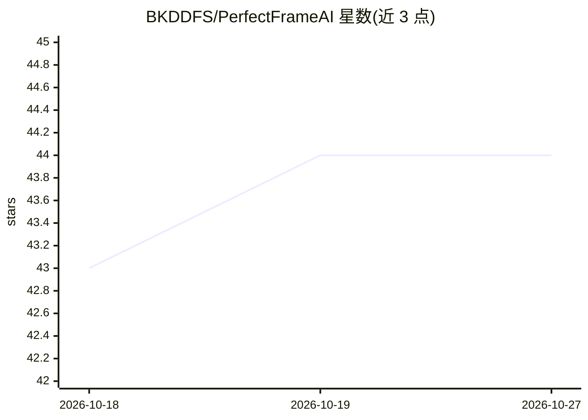

# BKDDFS/PerfectFrameAI

⭐ 44 · Python · NOASSERTION · 推送 2026-09-18 · [GitHub](https://github.com/BKDDFS/PerfectFrameAI) · 个人维护

**用 NIMA 模型从视频/图集中自动挑出最美帧的 Docker 服务**

基于 Neural Image Assessment（NIMA，InceptionResNetV2 底座、AVA 数据集预训练权重）对图像打美学分的工具：将视频按 1 秒间隔拆帧、批量评分，每组保存最高分帧；或从图片文件夹筛出前 90% 高分图；也可跳过 AI 评分仅抽帧。以 Docker Compose 服务形式部署，通过 HTTP API 调用，支持 CPU 默认模式与 NVIDIA GPU 加速（CUDA 不可用时自动回退 CPU）。最低测试配置为 i5-4300U、8GB 内存。

## 筛选速览

| 维度 | 判定 | 备注 |
|---|---|---|
| AI 角色 | `ai-native` | 本体是模型或模型工具 |
| 许可风险 | `none` | NOASSERTION |
| 部署形态 | `self-host` | docker 或自建部署 |
| 模型依赖 | — | README 未给出锁定关系 |
| 硬件要求 | — | 无带数字的原话,不猜 |
| 安装摩擦 | `low` | 无编译、无系统依赖或容器化 |
| 成熟度 | — | 结构信号不足 |

## 能力要点

- NIMA 模型输出 10 类美学概率向量，加权均值得最终分数
- 视频拆帧批量评分并保存各组最高分帧为 .jpg
- Docker Compose 部署，HTTP API 触发抽取
- GPU（CUDA）加速模式，不可用时自动回退 CPU

## 适用场景

- 从视频中自动截取最美画面做封面或截图
- 从大量照片中筛选高质量图片
- 批量抽取视频全部帧用于后续处理

## 场景标签

`图像视频处理` · 领域:感知与多模态

## 证据(README 行号)

> L21:  <code>PerfectFrameAI</code> is a tool that uses artificial intelligence to analyze video materials
> L40:  Evaluates all frames in the batch using an AI model and assigns them a numerical score.
> L206:  The tool uses a model built according to the principles

## 星数曲线

2026-10-18 43 → 2026-10-27 44（+1）

---
*卡片 v1 · prompt 1.4 · 生成 2026-10-25 · 置信度 high · 依据 README sha `a44bc3cae489` · [字段定义](../../DATASET.md)*
