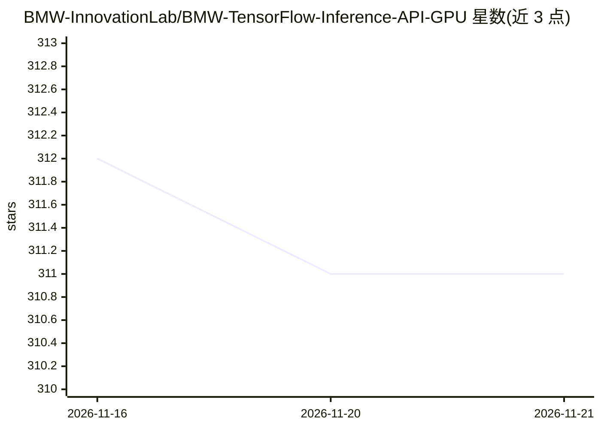

# BMW-InnovationLab/BMW-TensorFlow-Inference-API-GPU

⭐ 311 · Python · Apache-2.0 · 推送 2026-11-04 · [GitHub](https://github.com/BMW-InnovationLab/BMW-TensorFlow-Inference-API-GPU) · 组织维护

**面向开发者的 TensorFlow GPU 目标检测推理 REST API（含 OCR）**

基于 TensorFlow Object Detection API 构建的推理 REST API，在 GPU 上运行，仅支持 Linux。可同时加载多个目标检测模型，提供 /load、/detect、predict_image、predict_batch 等 HTTP 端点返回边界框，另含 OCR 端点从图像提取文本。通过 docker 或 docker swarm 部署，模型以 frozen_inference_graph.pb + pbtxt + Config.json 目录结构组织。使用 TensorFlow 1.13.1，附多种模型的单图推理耗时基准。

## 筛选速览

| 维度 | 判定 | 备注 |
|---|---|---|
| AI 角色 | `ai-native` | 本体是模型或模型工具 |
| 许可风险 | `permissive` | Apache-2.0 |
| 部署形态 | `self-host` | docker 或自建部署 |
| 模型依赖 | — | README 未给出锁定关系 |
| 硬件要求 | — | 无带数字的原话,不猜 |
| 安装摩擦 | `low` | 无编译、无系统依赖或容器化 |
| 成熟度 | — | 结构信号不足 |

## 能力要点

- 多模型同时加载的目标检测 REST API
- one_shot_ocr / ocr 端点做图像文本提取
- docker 与 docker swarm 两种部署方式，支持冗余与横向扩展
- 附 6 种检测模型的 CPU/GPU 推理耗时基准

## 适用场景

- 把训练好的检测模型部署为可调用的 HTTP 推理服务
- 高流量场景下用 docker swarm 扩展推理服务
- 通过 API 对图片做目标检测与文字提取

## 场景标签

`目标检测` `OCR` `推理引擎` · 领域:感知与多模态

## 证据(README 行号)

> L3: This is a repository for an object detection inference API using the Tensorflow framework.
> L118: Performs inference on specified model, image, and returns bounding-boxes

## 星数曲线

2026-11-16 312 → 2026-11-21 311（-1）

---
*卡片 v1 · prompt 1.4 · 生成 2026-11-17 · 置信度 high · 依据 README sha `222979d2658d` · [字段定义](../../DATASET.md)*
