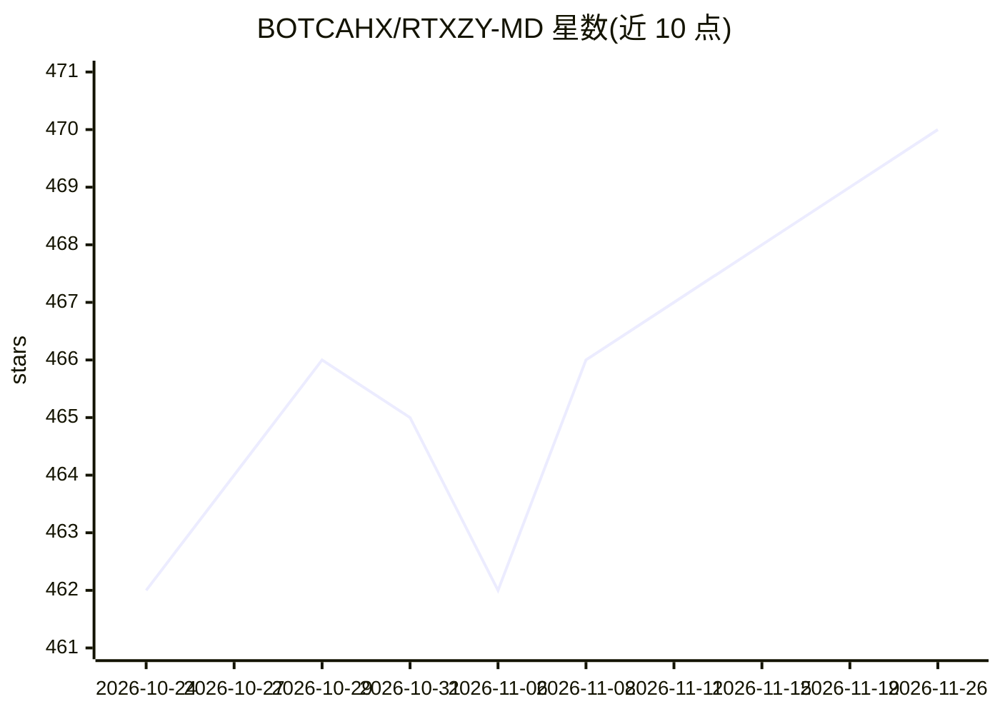

# BOTCAHX/RTXZY-MD

⭐ 470 · JavaScript · MIT · 推送 2026-11-25 · [GitHub](https://github.com/BOTCAHX/RTXZY-MD) · [官网](https://api.botcahx.eu.org) · 组织维护

**给 WhatsApp 用户的多设备机器人：自动收发消息与媒体处理**

基于 Node.js 22+ 与 zapo-js 库的多设备 WhatsApp 机器人：通过 Pairing Code（默认）或 QR Code（--qr）登录，支持私聊/群组/状态响应范围控制、SQLite/JSON/MongoDB/云适配多种数据库后端，内置 HTTP 服务器并移除 express 依赖。97% 功能依赖 BOTCAHX Rest API，运行前须在 config.js 填入 Apikey（免费档 15 请求/天）。附带 @zapo-js/mcp-server，可把会话操作暴露为 MCP tools 供 LLM agent 调用。不支持 Termux 运行。

## 筛选速览

| 维度 | 判定 | 备注 |
|---|---|---|
| AI 角色 | `ai-enhanced` | 去掉 AI 部分产品仍成立 |
| 许可风险 | `permissive` | MIT |
| 部署形态 | `library` | 以包/库形式分发 |
| 模型依赖 | — | README 未给出锁定关系 |
| 硬件要求 | — | 无带数字的原话,不猜 |
| 安装摩擦 | `medium` | 含编译或系统依赖之一 |
| 成熟度 | — | 结构信号不足 |

## 能力要点

- 多设备连接，默认 Pairing Code 认证，--qr 切换 QR Code
- 四种数据库后端：SQLite（默认）/JSON/MongoDB/云 adapter
- 内置 MCP 服务器，将会话与消息操作暴露为 LLM agent 工具
- 支持 Pterodactyl 面板、Render、Heroku 部署

## 适用场景

- 搭建自动回复消息的 WhatsApp 机器人
- 在 Pterodactyl 面板上托管 WhatsApp 机器人
- 通过 MCP 让 Claude Code 等 agent 调试 WhatsApp 会话

## 场景标签

`聊天机器人` · 领域:对话与助手

## 证据(README 行号)

> L153: Bot ini sudah menyertakan `@zapo-js/mcp-server` — server Model Context Protocol yang mengekspos sesi `zapo-js` (ko
> L107: Bot ini menggunakan **97% fitur dari Rest API**, jadi kamu **wajib mengisi Apikey**.
> L12: - **Menggunakan zapo-js** — `zapo-js`, dokumentasi & MCP di `zapo.to/mcp`

## 星数曲线

2026-10-24 462 → 2026-11-26 470（+8）

---
*卡片 v1 · prompt 1.4 · 生成 2026-11-25 · 置信度 mid · 依据 README sha `f4636ee7002f` · [字段定义](../../DATASET.md)*
