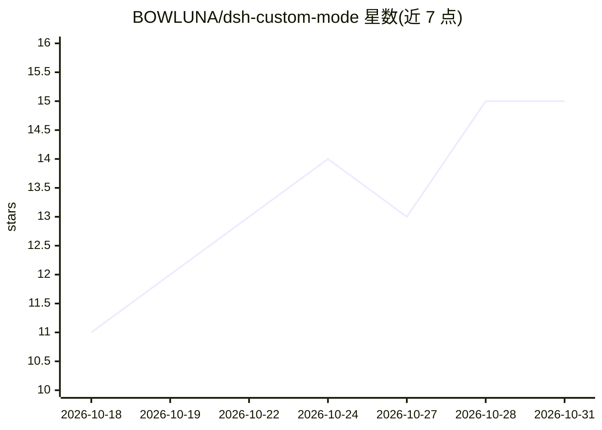

# BOWLUNA/dsh-custom-mode

⭐ 15 · JavaScript · MIT · 推送 2026-10-28 · [GitHub](https://github.com/BOWLUNA/dsh-custom-mode) · [官网](https://www.npmjs.com/package/dsh-custom-mode) · 个人维护 · 中文 README

**DeepSeek Harness 插件：编辑助手的系统提示词与插件开关**

dsh-custom-mode 是 DeepSeek Harness（dsh）宿主的一个插件，版本 2.3.0：在设置页创建和管理多个助手，编辑各助手的系统提示词（存储于 prompt.md，在模型步装配时重读）、选择基础模式（Coding/Writing/Chat 起始预设）与调整原生插件开关；提供整链路就绪校验流程、基于宿主原生更新能力的版本查询、npm 固定版本安装与卸载/清除脚本。不安装宿主、不配置模型凭据；声明兼容的宿主版本范围为 >=0.1.5-rc.2 至 <0.3.0-0 的多个区间，Windows/Electron 与 GPU 执行需独立验证。

## 筛选速览

| 维度 | 判定 | 备注 |
|---|---|---|
| AI 角色 | `ai-ecosystem` | LLM/agent 周边工具 |
| 许可风险 | `permissive` | MIT |
| 部署形态 | `library` | 以包/库形式分发 |
| 模型依赖 | locked-api |  |
| 硬件要求 | — | 无带数字的原话,不猜 |
| 安装摩擦 | `low` | 无编译、无系统依赖或容器化 |
| 成熟度 | `idea` | |

## 能力要点

- 多助手管理：系统提示词、基础模式、插件开关分别可编辑
- 提示词存于 prompt.md，模型步装配时重读，底层文件变更时拒绝过期保存
- 四步就绪校验流程（创建助手→临时提示词→新会话选择→就绪回复）
- 支持宿主原生更新检查、npm 固定版本升级与 .tgz/SHA256SUMS 发布物

## 适用场景

- 为不同任务在 dsh 中维护多个独立助手配置
- 调整某个助手的系统提示词并验证其在会话中生效
- 控制各助手可用的工具（终端/文件工具等插件开关）

## 场景标签

`提示工程` · 领域:Agent 开发

## 证据(README 行号)

> L5: Edit your DeepSeek Harness (`dsh`) assistants' system prompts, base modes and plugin switches. Keep separate assista
> L15: Start with an installed DeepSeek Harness and a model configured through its own interface. Check `dsh --version` ag

## 星数曲线

2026-10-18 11 → 2026-10-31 15（+4）

---
*卡片 v1 · prompt 1.4 · 生成 2026-10-31 · 置信度 high · 依据 README sha `2692d35b99e4` · [字段定义](../../DATASET.md)*
