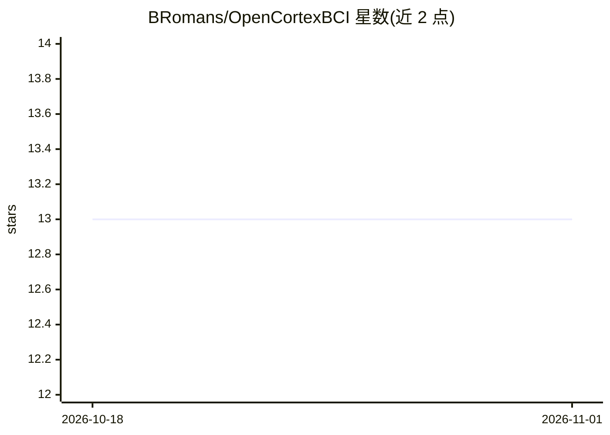

# BRomans/OpenCortexBCI

⭐ 13 · Jupyter Notebook · GPL-3.0 · 推送 2025-11-25 · [GitHub](https://github.com/BRomans/OpenCortexBCI) · 个人维护

**EEG 实时流处理工具：带分类器与可视化 GUI 的 BCI 应用**

面向脑机接口（BCI）应用的 EEG 流处理工具：通过 LabStreamingLayer（LSL）协议接收/发送数据，兼容 Brainflow 文档所列的任意 EEG 板卡。功能包括实时绘图 GUI、带通/陷波滤波、信号质量估计、自定义标记、外部触发 inlet 与原始 EEG outlet 流，以及可加载任意 Scikit-Learn 模型的通用分类器接口，并输出含 ROC 曲线与混淆矩阵的交叉验证图。以 pip 包提供，开发中状态，建议在虚拟环境安装。

## 筛选速览

| 维度 | 判定 | 备注 |
|---|---|---|
| AI 角色 | `ai-native` | 本体是模型或模型工具 |
| 许可风险 | `viral` | GPL-3.0 |
| 部署形态 | `library` | 以包/库形式分发 |
| 模型依赖 | — | README 未给出锁定关系 |
| 硬件要求 | — | 无带数字的原话,不猜 |
| 安装摩擦 | `low` | 无编译、无系统依赖或容器化 |
| 成熟度 | `idea` | |

## 能力要点

- LSL 协议双向流：接收/发送 EEG 数据
- 实时带通/陷波滤波与信号质量估计
- 可加载任意 Scikit-Learn 模型的通用分类器接口
- ROC 曲线与混淆矩阵的交叉验证图

## 适用场景

- 构建实时 BCI 或神经反馈应用
- 实时查看并过滤 EEG 信号质量
- 用自定义 Scikit-Learn 模型对 EEG 数据做在线分类

## 场景标签

 · 领域:脑机接口/信号处理

## 证据(README 行号)

> L2: OpenCortex is a fully-featured EEG streamer that includes a classifier and a GUI to visualize the data in real-time.
> L15: - General-purpose classifier interface that can be initialized with any model from Scikit-Learn

## 星数曲线

2026-10-18 13 → 2026-11-01 13（+0）

---
*卡片 v1 · prompt 1.4 · 生成 2026-10-31 · 置信度 high · 依据 README sha `814e82750cc2` · [字段定义](../../DATASET.md)*
