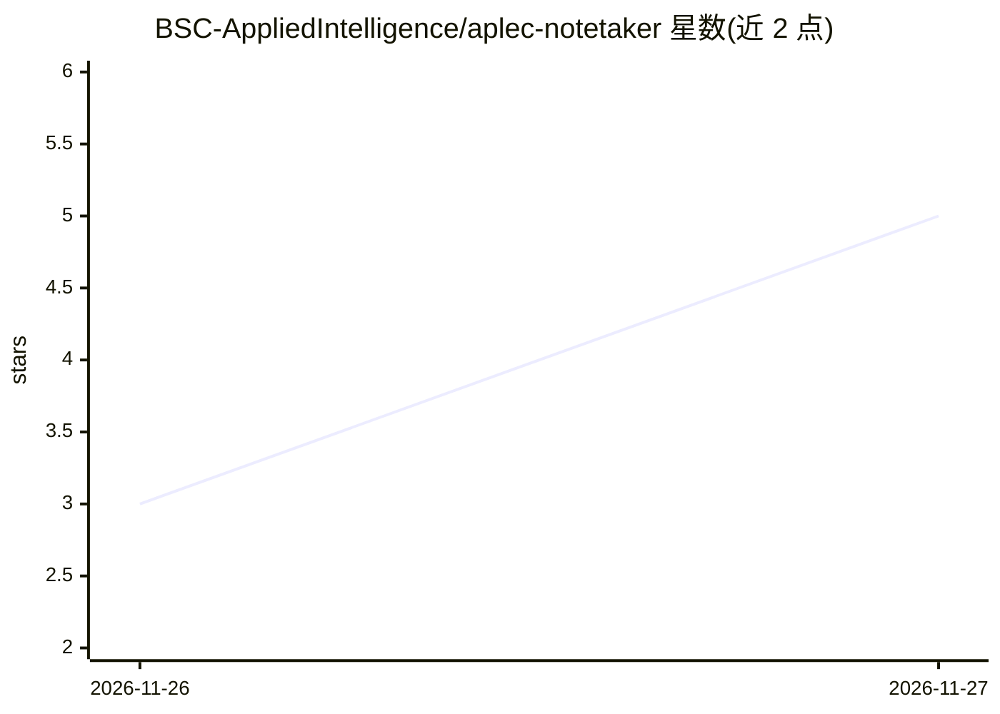

# BSC-AppliedIntelligence/aplec-notetaker

⭐ 5 · Python · Apache-2.0 · 推送 2026-11-25 · [GitHub](https://github.com/BSC-AppliedIntelligence/aplec-notetaker) · 组织维护

**团队自托管会议记录：录制会议并用本地 GPU 转写生成纪要**

面向团队的自托管会议笔记系统：通过 Chrome 扩展录制 Google Meet、Teams、Zoom 会议页面与麦克风双通道音频并上传到自己的服务器，用 whisper.cpp（large-v3）转写、pyannote 做说话人分离，结合页面说话人指示与可选声纹命名发言人，再由用户选择的 LLM（本地 open-weights 模型或任意 OpenAI 兼容 API）生成结构化纪要（摘要、决定、行动项、待解决问题），并提供团队 Web 应用（Google 登录、管理员审批、搜索、分享）。音频在本机处理；要求 NVIDIA CUDA GPU，whisper.cpp 需从源码编译。

## 筛选速览

| 维度 | 判定 | 备注 |
|---|---|---|
| AI 角色 | `ai-native` | 本体是模型或模型工具 |
| 许可风险 | `permissive` | Apache-2.0 |
| 部署形态 | `library` | 以包/库形式分发 |
| 模型依赖 | — | README 未给出锁定关系 |
| 硬件要求 | — | 无带数字的原话,不猜 |
| 安装摩擦 | `high` | 编译与系统依赖俱全 |
| 成熟度 | — | 结构信号不足 |

## 能力要点

- Chrome 扩展录制会议标签页与麦克风双通道音频，无需会议机器人
- whisper.cpp（large-v3）转写 + 语言 ID 校验，支持多语种会议逐句按语言转写
- pyannote 说话人分离，结合页面指示与可选声纹命名发言人
- LLM 可选：本地 llama.cpp 服务器或任意 OpenAI 兼容 API

## 适用场景

- 团队自托管记录并转写 Google Meet / Teams / Zoom 会议
- 生成含行动项和负责人的结构化会议纪要
- 对单场会议用问答检索转录内容
- 多语言混合会议的逐句转写与发言人命名

## 场景标签

`语音识别` `AI 写作` · 领域:内容生成

## 证据(README 行号)

> L6: Self-hosted meeting notes for a team. Aplec records Google Meet, Microsoft Teams and
> L8: structured notes (summary, decisions, action items with owners, open questions)
> L21: - **Transcription** with whisper.cpp (large-v3), including meetings that switch

## 星数曲线

2026-11-26 3 → 2026-11-27 5（+2）

---
*卡片 v1 · prompt 1.4 · 生成 2026-11-26 · 置信度 high · 依据 README sha `75c2391af70e` · [字段定义](../../DATASET.md)*
