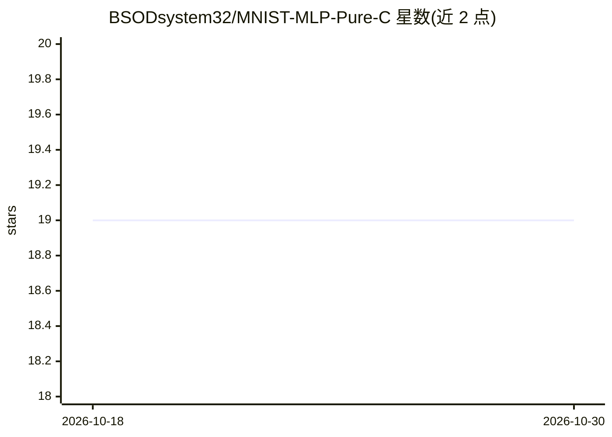

# BSODsystem32/MNIST-MLP-Pure-C

⭐ 19 · C · MIT · 推送 2026-07-30 · [GitHub](https://github.com/BSODsystem32/MNIST-MLP-Pure-C) · 个人维护 · 中文 README

**纯 C99 手写 MLP：MNIST 训练与裸机边缘推理**

不依赖任何外部 ML/数学库（无 BLAS/cuDNN）的纯 C99 全连接神经网络：训练框架含 BatchNorm、Dropout、带动量 SGD、OpenMP 多线程数据增强（平移/旋转/缩放/弹性/噪声），MNIST 测试精度约 98%。推理引擎面向裸机边缘设备（如 ARM Cortex-M），零 malloc，通过 BatchNorm 折叠将参数并入全连接权重，交叉编译后模型占约 800KB Flash、缓冲 <2KB SRAM。以 Makefile 构建，提供下载/训练/导出/基准测试命令。

## 筛选速览

| 维度 | 判定 | 备注 |
|---|---|---|
| AI 角色 | `ai-native` | 本体是模型或模型工具 |
| 许可风险 | `permissive` | MIT |
| 部署形态 | `None` |  |
| 模型依赖 | — | README 未给出锁定关系 |
| 硬件要求 | — | 无带数字的原话,不猜 |
| 安装摩擦 | `medium` | 含编译或系统依赖之一 |
| 成熟度 | — | 结构信号不足 |

## 能力要点

- 零外部依赖的 C99 训练框架（BatchNorm/Dropout/SGD Momentum）
- 零 malloc、BatchNorm 折叠的裸机推理引擎
- 3 级循环分块的缓存友好矩阵乘法与 AVX2 向量化提示
- OpenMP 线程安全数据增强流水线（PCG32 RNG）

## 适用场景

- 从零理解神经网络的训练与推理实现
- 将 MNIST 模型部署到 ARM Cortex-M 等资源受限设备
- 在无 BLAS/CUDA 环境下训练手写数字分类器

## 场景标签

`推理引擎` `模型训练` · 领域:训练与推理

## 证据(README 行号)

> L14: 1. **Training (`src/`)**: A highly optimized training framework featuring BatchNorm, Dropout, SGD with Momentum, an
> L15: 2. **Inference (`infer/`)**: A bare-metal ready, zero-malloc inference engine that uses **BatchNorm Folding** to ag

## 星数曲线

2026-10-18 19 → 2026-10-30 19（+0）

---
*卡片 v1 · prompt 1.4 · 生成 2026-10-29 · 置信度 high · 依据 README sha `009fd19531a0` · [字段定义](../../DATASET.md)*
