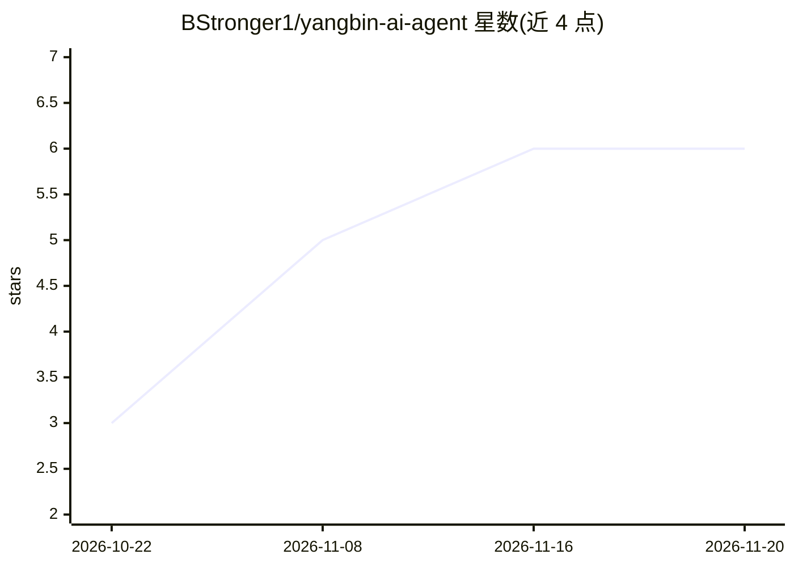

# BStronger1/yangbin-ai-agent

⭐ 6 · Java · 推送 2026-10-31 · [GitHub](https://github.com/BStronger1/yangbin-ai-agent) · 个人维护 · 中文 README

**面向开发者的多空间 AI 智能体工作台（对话/任务/编程）**

以 Spring Boot 3 + Java 21 + Spring AI + Vue 3 构建，含 Python 账号网关与基于 pi SDK 的 Node.js Coding 运行时。提供通用 Chat/Work、ReAct 智能体 YangbinManus 与 Coding Agent 三个空间，支持 BYOK 多厂商模型接入、工具审批三档控制、Token 配额与熔断治理、42 项技能与 11 个工作伙伴。RAG、MCP、命令执行为可选模块需额外配置；命令工具依赖 Linux bubblewrap 隔离，文件产物存于服务端账号私有目录而非本机仓库。

## 筛选速览

| 维度 | 判定 | 备注 |
|---|---|---|
| AI 角色 | `ai-native` | 本体是模型或模型工具 |
| 许可风险 | `none` | — |
| 部署形态 | `None` |  |
| 模型依赖 | — | README 未给出锁定关系 |
| 硬件要求 | — | 无带数字的原话,不猜 |
| 安装摩擦 | `medium` | 含编译或系统依赖之一 |
| 成熟度 | — | 结构信号不足 |

## 能力要点

- Chat/Work/Coding 三工作空间，BYOK 多厂商模型管理与 AES-256-GCM 密钥加密
- 工具执行三档审批与 Linux bubblewrap 隔离命令运行
- 运行治理：并发准入、每日配额、持久用量账本与失败熔断
- 42 项技能、11 个领域工作伙伴与 MCP 工作台（可选）

## 适用场景

- 自带 API Key 搭建私有对话与任务执行工作台
- 让 Coding Agent 按审批流程读写服务端项目文件
- 按账号管理模型用量、配额与请求熔断

## 场景标签

`编码 Agent` `AI 助手` · 领域:编码与开发

## 证据(README 行号)

> L5: 基于 **Spring Boot 3 + Java 21 + Spring AI + Vue 3** 构建的 AI 智能体工作台，集成 AI 恋爱大师、ReAct 自主规划智能体 **YangbinManus** 和基于 **pi*
> L103: |编码运行时|Node.js ≥22.19、pi SDK 1.3.0、Undici|复用 pi 的编码会话与模型循环，项目负责工作区、审批、进程桥接及安全约束；不是从零自研 pi|
> L167: 本项目是 liyupi/yu-ai-agent 的课程学习改造，个人扩展包括账号工作台、验证链路、pi适配和BYOK体验。pi SDK的版权许可保留在 coding-agent/PI-LICENSE。原始快照未附整体许可证，当前

## 星数曲线

2026-10-22 3 → 2026-11-20 6（+3）

---
*卡片 v1 · prompt 1.4 · 生成 2026-11-20 · 置信度 high · 依据 README sha `27aaa7afc91e` · [字段定义](../../DATASET.md)*
