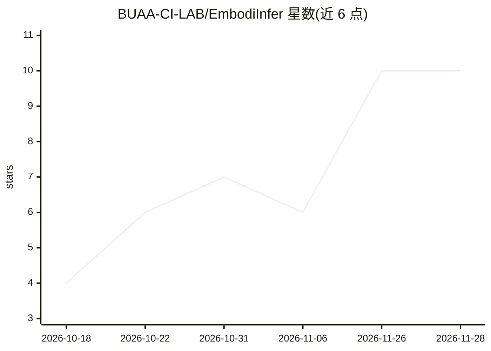

# BUAA-CI-LAB/EmbodiInfer

⭐ 10 · Python · Apache-2.0 · 推送 2026-11-25 · [GitHub](https://github.com/BUAA-CI-LAB/EmbodiInfer) · [官网](https://embodiinfer.readthedocs.io/) · 组织维护 · 中文 README

**具身模型推理与 RL rollout 引擎：加速 VLA/VLN 执行**

面向具身 AI 的推理引擎，通过模型专用 kernel、CUDA Graphs 与硬件感知精度加速 VLA 操作与 VLN 导航模型执行。支持循环导航会话、上下文复用、请求批处理与多 GPU 执行，并提供 RL 集成所需的动作采样、log 概率与权重重载接口。支持 π0.5、GR00T N1.7、OpenVLA-OFT、ActiveVLN、StreamVLN 等模型。需 Python 3.10+ 与 uv，通过 git clone 源码安装；部署演示依赖姊妹项目 EmbodiRun。

## 筛选速览

| 维度 | 判定 | 备注 |
|---|---|---|
| AI 角色 | `ai-ecosystem` | LLM/agent 周边工具 |
| 许可风险 | `permissive` | Apache-2.0 |
| 部署形态 | `None` |  |
| 模型依赖 | local-ok | 支持本地模型 |
| 硬件要求 | — | 无带数字的原话,不猜 |
| 安装摩擦 | `medium` | 含编译或系统依赖之一 |
| 成熟度 | — | 结构信号不足 |

## 能力要点

- CUDA Graphs、编译路径、融合 kernel 与硬件特定精度加速模型执行
- 支持循环导航会话、请求批处理与多 GPU 执行
- RL 集成：动作采样、log 概率与权重 refit
- 支持 π0.5/GR00T N1.7/OpenVLA-OFT/ActiveVLN 等 10 个模型

## 适用场景

- 为机器人 VLA 操作模型提供低延迟推理执行
- 在 RLinf 等训练框架中作为 rollout 后端
- 在 RTX 4090 或 Jetson 上运行 VLN 导航推理

## 场景标签

`推理引擎` · 领域:训练与推理

## 证据(README 行号)

> L16: **EmbodiInfer is a high-performance inference engine for embodied AI.** It accelerates VLA manipulation and VLN nav
> L125: ## One engine, from inference to rollout
> L131: - **RL integration:** action sampling, log probabilities and weight refit for supported policies.

## 星数曲线

2026-10-18 4 → 2026-11-28 10（+6）

---
*卡片 v1 · prompt 1.4 · 生成 2026-11-26 · 置信度 high · 依据 README sha `537141571d44` · [字段定义](../../DATASET.md)*
