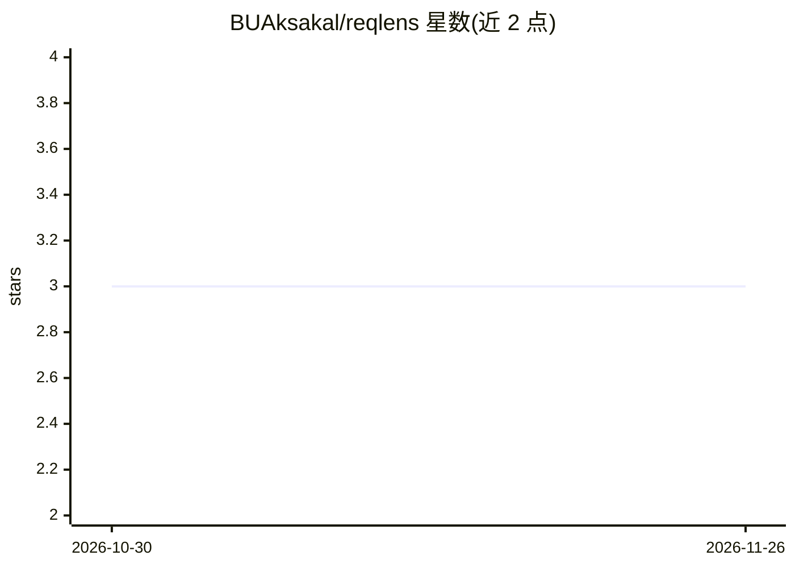

# BUAksakal/reqlens

⭐ 3 · Python · MIT · 推送 2026-10-29 · [GitHub](https://github.com/BUAksakal/reqlens) · [官网](https://reqlens.streamlit.app/) · 个人维护

**面向汽车需求文档的 AI 审阅工具：提取需求并找矛盾**

ReqLens 读取汽车 PDF 规格书，提取需求条目并标记含糊措辞与相互矛盾的需求。流程为 LangGraph 图：PyMuPDF+regex 经典抽取、Gemini LLM 分块抽取、LlamaIndex RAG 冲突 agent 检索相关条目、supervisor agent 二次核验，并在 LangGraph interrupt 处暂停等待工程师批准或驳回每个发现，决策写入 SQLite 并计算通过率。超 60 页文档拒绝处理，每条 LLM 回答按文档缓存，supervisor 无模型时回退到规则。提供 Streamlit Web 界面、typer CLI、Docker 镜像与在线 demo。

## 筛选速览

| 维度 | 判定 | 备注 |
|---|---|---|
| AI 角色 | `ai-native` | 本体是模型或模型工具 |
| 许可风险 | `permissive` | MIT |
| 部署形态 | `self-host` | docker 或自建部署 |
| 模型依赖 | — | README 未给出锁定关系 |
| 硬件要求 | — | 无带数字的原话,不猜 |
| 安装摩擦 | `low` | 无编译、无系统依赖或容器化 |
| 成熟度 | — | 结构信号不足 |

## 能力要点

- LangGraph supervisor + LlamaIndex RAG 冲突 agent 的双 agent 工作流，engineer-in-the-loop 审批
- 经典 regex 抽取与 Gemini LLM 抽取按文档自动路由，8 页分块加缓存
- 五 Gemini 模型自动回退、无模型时 supervisor 回退到规则
- 自带 GAIA 风格三级难度基准（dev/hold-out test 集）与检索 hit@k 评估

## 适用场景

- 上传供应商规格书 PDF，批量提取需求条目
- 在测试阶段之前发现数十页之外的矛盾需求
- 标记 fast/sufficient 等无法测试的含糊措辞
- 运行 reqlens bench 在自建基准上评估冲突检测效果

## 场景标签

`RAG` · 领域:知识与检索

## 证据(README 行号)

> L12:  ReqLens reads automotive PDF specifications, extracts the requirements and finds the ones that are ambiguous or co
> L18: ReqLens is an **end-to-end requirements review tool built around AI agents**. You upload a specification, and ReqLe
> L55: |**Conflict check**|A **LlamaIndex agent** looks up related requirements through a semantic index (RAG) and decides

## 星数曲线

2026-10-30 3 → 2026-11-26 3（+0）

---
*卡片 v1 · prompt 1.4 · 生成 2026-11-22 · 置信度 high · 依据 README sha `a9bad6a63583` · [字段定义](../../DATASET.md)*
