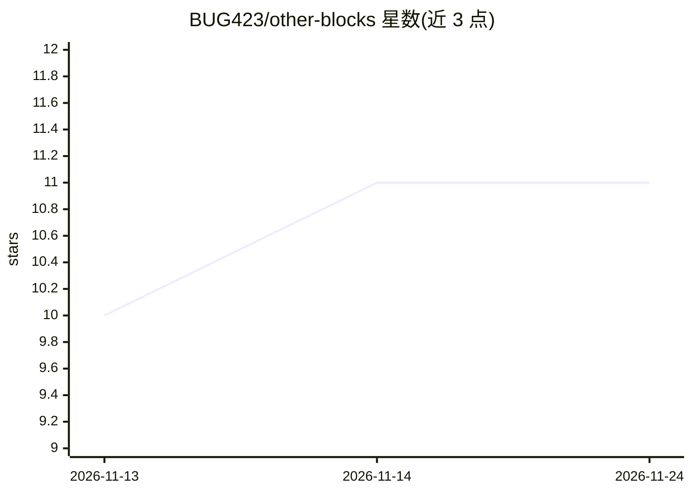

# BUG423/other-blocks

⭐ 11 · Python · NOASSERTION · 推送 2026-10-11 · [GitHub](https://github.com/BUG423/other-blocks) · 个人维护 · 中文 README

**给 CV 与时序任务开发者提供即插即用 PyTorch 神经网络模块库**

系统整理、实现与验证神经网络功能模块的 PyTorch 模块动物园：包含 77 个原创模块与 39 个提取自 TPAMI/CVPR/ECCV/ICCV/NeurIPS 论文的等价模块，按注意力、门控、频域、多尺度等 8 类组织。每个模块为独立 nn.Module，遵循 [B,C,H,W] 形状保持契约与统一构造函数约定，并通过内置 BCL 适配器将模块迁移至 1D 时序任务。仅依赖 torch/typing/math，支持 CPU/CUDA/MPS 与混合精度。许可为 CC BY-NC-ND 4.0，禁止商用与演绎分发。

## 筛选速览

| 维度 | 判定 | 备注 |
|---|---|---|
| AI 角色 | `ai-native` | 本体是模型或模型工具 |
| 许可风险 | `none` | NOASSERTION |
| 部署形态 | `None` |  |
| 模型依赖 | — | README 未给出锁定关系 |
| 硬件要求 | — | 无带数字的原话,不猜 |
| 安装摩擦 | `medium` | 含编译或系统依赖之一 |
| 成熟度 | — | 结构信号不足 |

## 能力要点

- 116 个模块：77 原创 + 39 个顶会论文等价提取
- 统一张量契约：输入输出形状一致，即插即用插入任意 CNN/Transformer 骨干
- BCL 时序适配器将 1D/2D 模块迁移至惯性导航与时序任务
- 每个模块附设计简介/结构说明/论文写法/适用任务四段式文档

## 适用场景

- 为现有 CNN/Transformer 骨干插入注意力或特征融合模块
- 将 2D 视觉模块复用到惯性导航等 1D 时序任务
- 为论文实验查找模块的标准写法参考

## 场景标签

 · 领域:深度学习/计算机视觉组件库

## 证据(README 行号)

> L10: > **other-blocks** 是一个系统整理、实现和验证神经网络功能模块的开源仓库，覆盖计算机视觉（2D）与时序数据（1D BCL 序列）感知任务的即插即用 PyTorch 神经网络模块动物园。
> L34: |🧩 **即插即用**|每个模块封装为独立的 `nn.Module`，零侵入无缝插入任意主流 CNN 或 Transformer 骨干。|
> L37: |🌊 **时序生态扩展**|内置 BCL（Batch-Channel-Length）时序格式适配器，将成熟的 1D/2D 模块无缝迁移至惯性导航与时序分析任务。|

## 星数曲线

2026-11-13 10 → 2026-11-24 11（+1）

---
*卡片 v1 · prompt 1.4 · 生成 2026-11-19 · 置信度 high · 依据 README sha `6afab0ebde69` · [字段定义](../../DATASET.md)*
