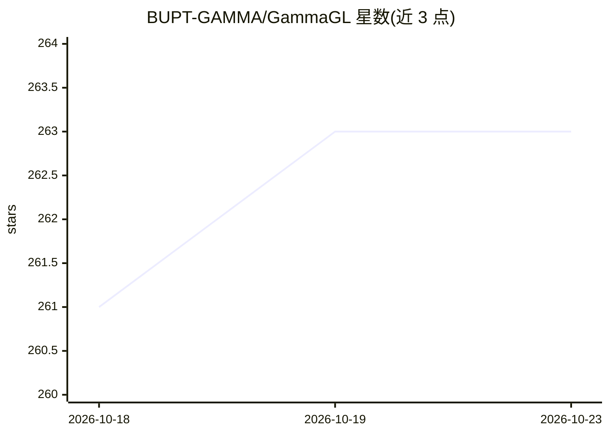

# BUPT-GAMMA/GammaGL

⭐ 263 · Python · Apache-2.0 · 推送 2026-07-05 · [GitHub](https://github.com/BUPT-GAMMA/GammaGL) · 组织维护 · 中文 README

**多后端图神经网络库：一套代码跑四种深度学习框架**

基于 TensorLayerX 的多后端图学习库，支持 TensorFlow、PyTorch、PaddlePaddle、MindSpore 作为后端，同一份示例代码可在不同后端与硬件（Nvidia GPU、华为昇腾）上运行。API 仿照 PyTorch Geometric 的张量中心设计，收录约 70 个 GNN 模型，提供数据结构、消息传递与采样模块，支持 GPU 采样与 neo4j 等图数据库。可选 llm/gfm 扩展安装 GraphGPT、LLaGA 等 LLM/图基础模型相关功能。要求 Python≥3.9、Linux，pip 安装，SIGIR 2023 资源论文。

## 筛选速览

| 维度 | 判定 | 备注 |
|---|---|---|
| AI 角色 | `ai-ecosystem` | LLM/agent 周边工具 |
| 许可风险 | `permissive` | Apache-2.0 |
| 部署形态 | `library` | 以包/库形式分发 |
| 模型依赖 | — | README 未给出锁定关系 |
| 硬件要求 | — | 无带数字的原话,不猜 |
| 安装摩擦 | `high` | 编译与系统依赖俱全 |
| 成熟度 | — | 结构信号不足 |

## 能力要点

- TensorFlow/PyTorch/Paddle/MindSpore 四后端，示例代码同一份
- 约 70 个 GNN 模型（GCN、GAT、GraphSAGE、Graphormer 等）
- 支持 Nvidia GPU 与华为昇腾硬件
- 可选 llm-gfm 扩展（GraphGPT、LLaGA、LLMRec 等）

## 适用场景

- 在同一代码库上切换深度学习框架训练 GNN
- 在昇腾等非 Nvidia 硬件上运行图神经网络
- 使用现成 GNN 模型做引文图等节点分类任务
- 自定义消息传递层实现新图神经网络

## 场景标签

 · 领域:图机器学习/库

## 证据(README 行号)

> L18: GammaGL is a multi-backend graph learning library based on TensorLayerX, which supports TensorFlow, PyTorch, Paddle
> L26: GammaGL supports multiple deep learning backends, such as TensorFlow, PyTorch, Paddle and MindSpore. Different from

## 星数曲线

2026-10-18 261 → 2026-10-23 263（+2）

---
*卡片 v1 · prompt 1.4 · 生成 2026-10-22 · 置信度 high · 依据 README sha `ae00bc007aa6` · [字段定义](../../DATASET.md)*
