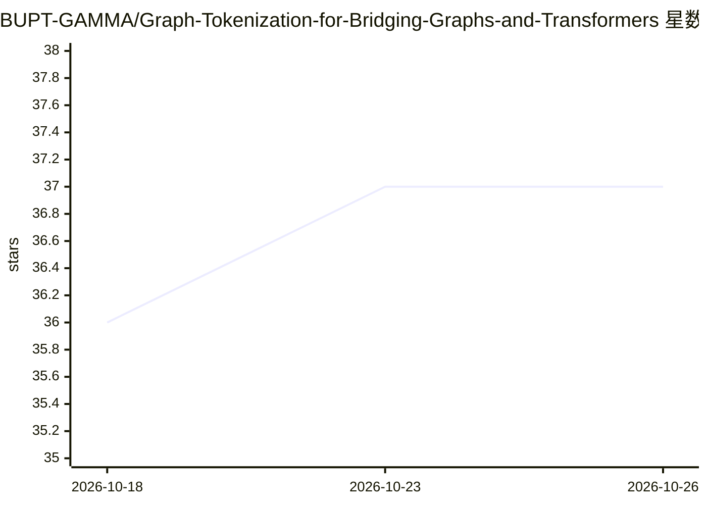

# BUPT-GAMMA/Graph-Tokenization-for-Bridging-Graphs-and-Transformers

⭐ 37 · Python · 推送 2026-05-25 · [GitHub](https://github.com/BUPT-GAMMA/Graph-Tokenization-for-Bridging-Graphs-and-Transformers) · 组织维护 · 中文 README

**将图结构数据转为 token 序列以接入标准 Transformer 的研究框架**

ICLR 2026 论文的官方实现：把任意带标签图经结构引导的可逆序列化（频率引导欧拉回路等 6 种方法）转为序列，训练 BPE 词表压缩 token，使 BERT、GTE 等现成 Transformer 无需架构修改即可处理图数据，过程可逆可重建原图。提供数据预处理、MLM 预训练、微调与批量实验脚本，在 14 个图分类/回归基准上报告结果。目前仅 qm9test 数据集经全流程验证，微调脚本要求 CUDA。

## 筛选速览

| 维度 | 判定 | 备注 |
|---|---|---|
| AI 角色 | `ai-native` | 本体是模型或模型工具 |
| 许可风险 | `none` | — |
| 部署形态 | `library` | 以包/库形式分发 |
| 模型依赖 | — | README 未给出锁定关系 |
| 硬件要求 | — | 无带数字的原话,不猜 |
| 安装摩擦 | `medium` | 含编译或系统依赖之一 |
| 成熟度 | `idea` | |

## 能力要点

- 结构引导的可逆序列化 + BPE 训练图 token 词表，压缩至约 10% 长度
- 现成 Transformer（BERT/GTE）无需架构修改直接处理图数据
- 支持 6 种序列化方法，默认 Feuler 兼具可逆性与确定性，O(|E|) 复杂度
- 覆盖 14 个图分类/回归基准的复现实验脚本

## 适用场景

- 分子、生物医学等图数据上用标准 Transformer 做分类/回归
- 复现论文的全部 14 个数据集实验与效率分析
- 研究不同图序列化方法对 BPE tokenization 的影响

## 场景标签

`微调` · 领域:训练与推理

## 证据(README 行号)

> L11: The success of large pretrained Transformers is closely tied to tokenizers, which convert raw input into discrete s
> L13: The framework combines **reversible graph serialization** with **Byte Pair Encoding (BPE)**, the de facto standard 

## 星数曲线

2026-10-18 36 → 2026-10-26 37（+1）

---
*卡片 v1 · prompt 1.4 · 生成 2026-10-25 · 置信度 mid · 依据 README sha `c8606b8d5e35` · [字段定义](../../DATASET.md)*
