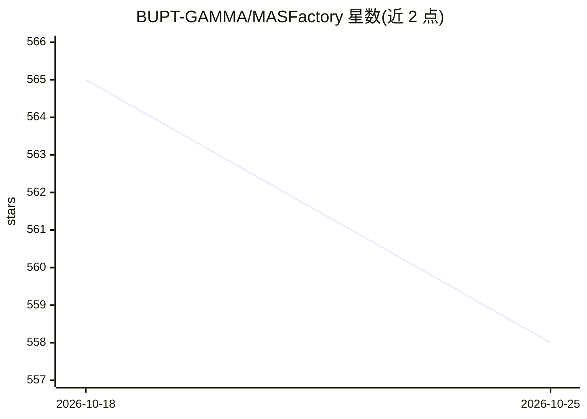

# BUPT-GAMMA/MASFactory

⭐ 558 · Python · Apache-2.0 · 推送 2026-10-14 · [GitHub](https://github.com/BUPT-GAMMA/MASFactory) · [官网](https://masfactory.dev) · 组织维护 · 中文 README

**面向多智能体系统的图编排框架：意图生成可执行工作流**

BUPT-GAMMA 团队维护的多智能体系统编排框架，以 Node/Edge 图结构表示 agent 协作关系，抽象为骨架层、组件层（Agent/Graph/Loop/Switch/Human 等）、协议层与交互层。核心机制 Vibe Graphing 将自然语言意图转化为图设计，经人工确认迭代后编译为可执行工作流；同一系统内支持代码编写、可视化拖拽与自然语言编排三种模式，统一进入 Visualizer 预览、运行追踪与人机交互。通过 LiteLLM 可选依赖接入 100+ 模型提供商，限制为需 Python>=3.10。

## 筛选速览

| 维度 | 判定 | 备注 |
|---|---|---|
| AI 角色 | `ai-ecosystem` | LLM/agent 周边工具 |
| 许可风险 | `permissive` | Apache-2.0 |
| 部署形态 | `library` | 以包/库形式分发 |
| 模型依赖 | — | README 未给出锁定关系 |
| 硬件要求 | — | 无带数字的原话,不猜 |
| 安装摩擦 | `low` | 无编译、无系统依赖或容器化 |
| 成熟度 | — | 结构信号不足 |

## 能力要点

- Vibe Graphing：自然语言意图→图设计→可执行工作流
- Node/Edge 图组件体系，支持子图、循环、分支与 human-in-the-loop
- 代码/可视化/Vibe Graphing 三种开发模式共存，统一运行时追踪
- LiteLLM 可选扩展接入 100+ 模型提供商（Anthropic/Gemini/Ollama 等）

## 适用场景

- 从自然语言需求出发快速搭建多 agent 协作工作流
- 在可视化环境中预览、追踪和干预多智能体系统运行
- 复用内置图模式（InstructorAssistantGraph/BrainstormingGraph）构建教学、头脑风暴类应用

## 场景标签

`多智能体` `Agent 框架` · 领域:Agent 开发

## 证据(README 行号)

> L35: **MASFactory** is a graph-centric framework for orchestrating Multi-Agent Systems with **Vibe Graphing**:
> L78: MASFactory adopts the widely used graph-centric approach to multi-agent orchestration and abstracts the system into
> L105:  > - Natural-language workflow construction based on `Vibe Graphing`, reducing the human cost of system developmen

## 星数曲线

2026-10-18 565 → 2026-10-25 558（-7）

---
*卡片 v1 · prompt 1.4 · 生成 2026-10-22 · 置信度 high · 依据 README sha `3eb589966151` · [字段定义](../../DATASET.md)*
