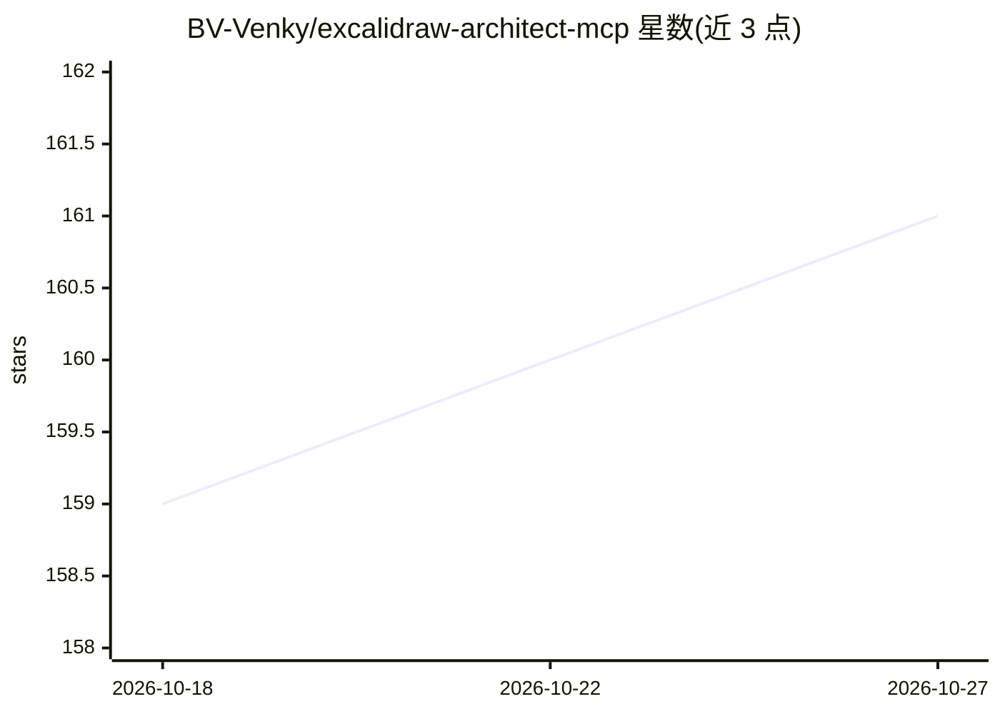

# BV-Venky/excalidraw-architect-mcp

⭐ 161 · Python · MIT · 推送 2026-08-25 · [GitHub](https://github.com/BV-Venky/excalidraw-architect-mcp) · 个人维护

**为 AI IDE 生成 25 类 Excalidraw 手绘图的 MCP 服务器**

面向 Cursor、Claude Code、Windsurf 等 AI 编码工具的 MCP 服务器：LLM 只需描述图的结构（组件、参与者、数据点），引擎负责布局算法与样式计算，输出可继续编辑的 .excalidraw 文件，覆盖架构图、时序图、状态机、ER 图、甘特图、散点图等 25 种类型。支持自然语言修改已生成图表、50+ 技术组件自动样式、SVG/PNG 离线导出，并可将系统建模为可查询的架构知识图谱。pip 安装，完全离线运行，无需 API key。

## 筛选速览

| 维度 | 判定 | 备注 |
|---|---|---|
| AI 角色 | `ai-ecosystem` | LLM/agent 周边工具 |
| 许可风险 | `permissive` | MIT |
| 部署形态 | `library` | 以包/库形式分发 |
| 模型依赖 | — | README 未给出锁定关系 |
| 硬件要求 | — | 无带数字的原话,不猜 |
| 安装摩擦 | `low` | 无编译、无系统依赖或容器化 |
| 成熟度 | — | 结构信号不足 |

## 能力要点

- 25 种图类型，Sugiyama 分层布局引擎负责自动排版
- 生成可编辑的 .excalidraw 文件，支持自然语言修改 spec
- 50+ 技术组件（Kafka/PostgreSQL/Redis 等）自动样式识别
- 可选架构知识图谱：将系统持久化为 AI 可查询与 lint 的版本化模型

## 适用场景

- 入职新代码库时快速生成架构图与关键流程时序图
- 设计文档/RFC 中统一视觉语言地绘制架构、状态机与甘特图
- 把 Mermaid 图转换为可手动调整的 Excalidraw 图

## 场景标签

`知识图谱` · 领域:知识与检索

## 证据(README 行号)

> L24: Your LLM says what the components, actors, tiers, or data points are. The MCP picks the layout algorithm for that d
> L161: claude mcp add-json excalidraw-architect '{"type":"stdio","command":"excalidraw-architect-mcp"}' --scope user
> L173: **Windsurf / Other IDEs** - Same pattern; point to the `excalidraw-architect-mcp` command over stdio.

## 星数曲线

2026-10-18 159 → 2026-10-27 161（+2）

---
*卡片 v1 · prompt 1.4 · 生成 2026-10-22 · 置信度 high · 依据 README sha `5140ef5b7c03` · [字段定义](../../DATASET.md)*
