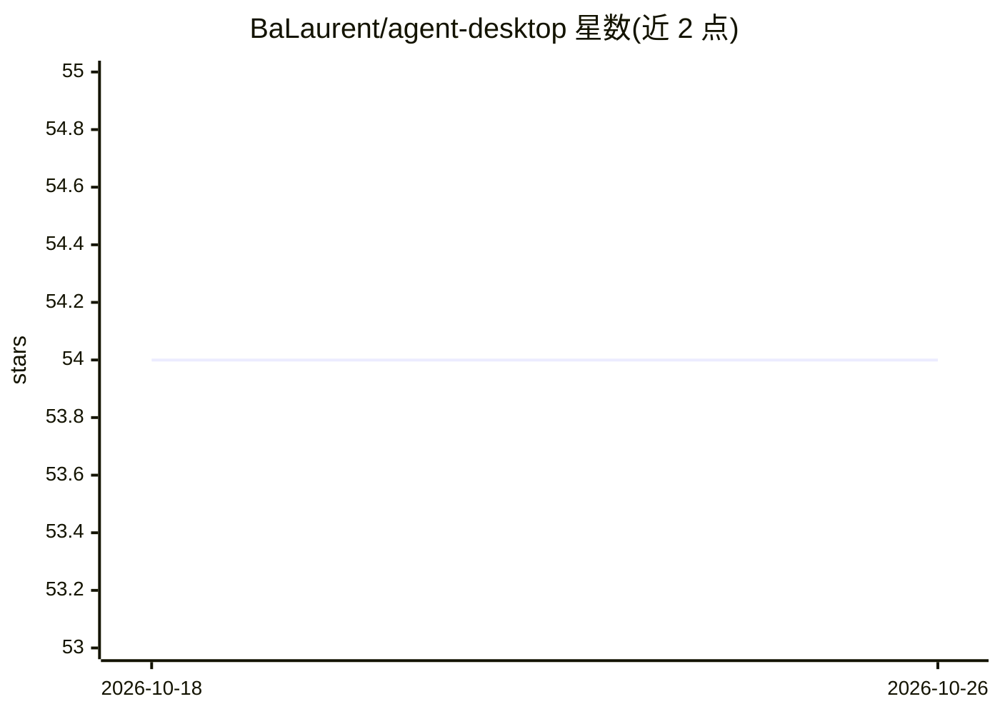

# BaLaurent/agent-desktop

⭐ 54 · TypeScript · AGPL-3.0 · 推送 2026-08-31 · [GitHub](https://github.com/BaLaurent/agent-desktop) · [官网](https://agent-desktop.site) · 个人维护

**面向 agent 的可配置 LLM 桌面客户端，默认 Claude**

基于 Electron 的桌面客户端，默认通过 Claude Agent SDK 运行，支持自定义 base URL 接入其他模型，并提供实验性的 PI Coding Agent 后端。功能包括流式聊天、OAuth/API key 认证、MCP 服务器（stdio/HTTP/SSE）、文件浏览器与 Jupyter、git 面板、定时任务、本地 whisper.cpp 语音输入、TTS 与主题定制，也可无头模式作为 Web 服务器或 Discord bot 运行。Linux/macOS/Windows 从 Releases 下载安装包，开发需 Node.js 环境。

## 筛选速览

| 维度 | 判定 | 备注 |
|---|---|---|
| AI 角色 | `ai-ecosystem` | LLM/agent 周边工具 |
| 许可风险 | `viral` | AGPL-3.0 |
| 部署形态 | `desktop` | 安装包/桌面程序 |
| 模型依赖 | locked-api |  |
| 硬件要求 | — | 无带数字的原话,不猜 |
| 安装摩擦 | `low` | 无编译、无系统依赖或容器化 |
| 成熟度 | — | 结构信号不足 |

## 能力要点

- 默认 Claude Agent SDK，任意模型可经自定义 base URL 接入
- MCP 服务器（stdio/HTTP/SSE）与 plan mode 审批
- 内置 git 面板、文件/Jupyter 浏览器、定时任务与语音（whisper.cpp/Piper/edge-tts）
- 无头模式可作为 Web 服务器或 Discord bot 运行

## 适用场景

- 在桌面上使用 Claude 或其他 LLM 完成 agent 任务
- 通过 MCP 服务器扩展 agent 能力并审批操作
- 无头部署为团队共享的 LLM 服务端

## 场景标签

`AI 助手` · 领域:对话与助手

## 证据(README 行号)

> L2: A desktop client for every LLM, built for agents. Claude by default — any model via a custom base URL. Plan mode app
> L14: - **Backends** — Claude Agent SDK (default) or PI Coding Agent *(experimental)*
> L20: - **MCP** — stdio, HTTP, and SSE Model Context Protocol servers

## 星数曲线

2026-10-18 54 → 2026-10-26 54（+0）

---
*卡片 v1 · prompt 1.4 · 生成 2026-10-24 · 置信度 high · 依据 README sha `4f87c967863c` · [字段定义](../../DATASET.md)*
