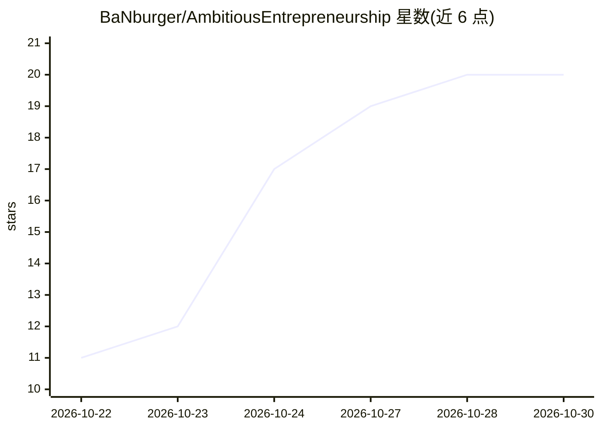

# BaNburger/AmbitiousEntrepreneurship

⭐ 20 · HTML · NOASSERTION · 推送 2026-10-26 · [GitHub](https://github.com/BaNburger/AmbitiousEntrepreneurship) · 个人维护

**面向创始人的 AI 时代创业验证开源课程（12 模块）**

由 Bastian Burger 维护的开放创业课程资料库：12 个模块加 Kickoff，每模块含讲座、案例、工作坊与作业，覆盖团队、问题验证、原型、Kill 决策、首批用户与融资等；另提供 7 个决策框架（如 Mom Test 备忘、Go/Pivot/Kill）与学生工具包。供高校课程、自学者与讲师免费使用，采用 CC BY-NC-SA 4.0 非商业许可。内容为纯文本 Markdown/HTML，可被 AI agent 读取。

## 筛选速览

| 维度 | 判定 | 备注 |
|---|---|---|
| AI 角色 | `ai-knowledge` | 知识聚合/清单类 |
| 许可风险 | `none` | NOASSERTION |
| 部署形态 | `None` |  |
| 模型依赖 | — | README 未给出锁定关系 |
| 硬件要求 | — | 无带数字的原话,不猜 |
| 安装摩擦 | `low` | 无编译、无系统依赖或容器化 |
| 成熟度 | — | 结构信号不足 |

## 能力要点

- 12 个模块，每模块含讲座、案例、工作坊、作业六部分结构
- 7 个独立决策框架一页纸（Mom Test、Go/Pivot/Kill、Default Alive 计算器等）
- CC BY-NC-SA 4.0 下免费使用与改编，支持教学场景
- 纯文本 Markdown/HTML 形式，可指向 AI agent 将模块转为技能

## 适用场景

- 创始人按周自学并验证或砍掉自己的创业想法
- 高校讲师选取模块开设创业课程
- AI 创业者参考 AI Startup Playbook 的模式与反模式

## 场景标签

`教程课程` · 领域:学习与行业

## 证据(README 行号)

> L7: **Free and open.** Every lecture, workshop, case study, homework, framework and template is in this repo, free under
> L102: Every part is plain text an AI agent can read. Workshops, homework, cases and frameworks are Markdown, and rebuilt

## 星数曲线

2026-10-22 11 → 2026-10-30 20（+9）

---
*卡片 v1 · prompt 1.4 · 生成 2026-10-28 · 置信度 high · 依据 README sha `729f8c2e40bf` · [字段定义](../../DATASET.md)*
