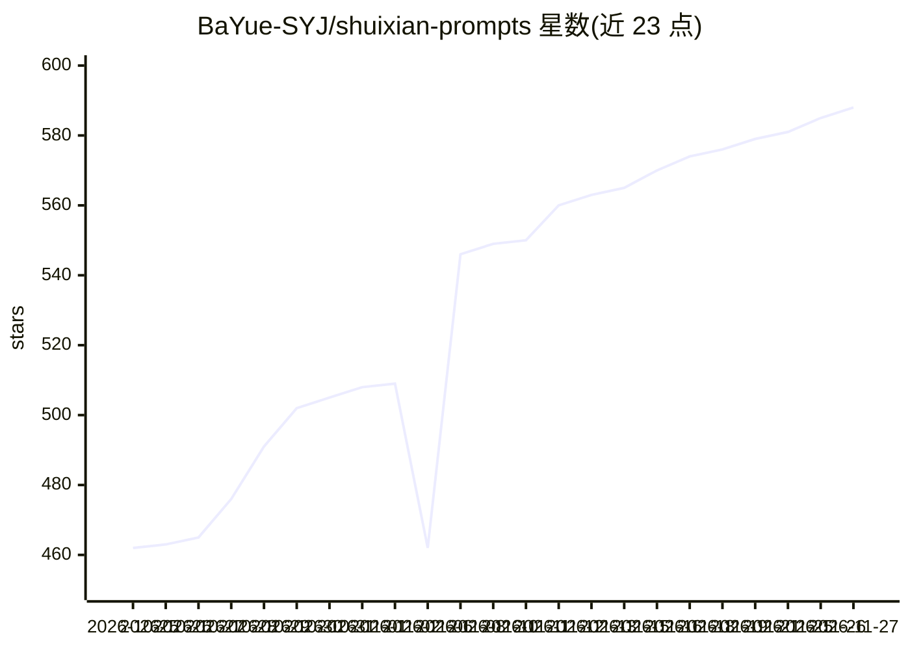

# BaYue-SYJ/shuixian-prompts

⭐ 588 · JavaScript · NOASSERTION · 推送 2026-11-12 · [GitHub](https://github.com/BaYue-SYJ/shuixian-prompts) · [官网](https://prompt.qqsrc.com/) · 个人维护 · 中文 README

**面向 AI 绘画使用者的中文提示词库：检索/分类/一键复制**

一个中文 AI 绘画提示词库站点，收录 6,601 条提示词，按 15 大类、79 细类组织，每条配生成效果图。提供关键词模糊搜索、拼音首字母检索、标签分面筛选、命令面板、一键复制与收藏合集管理，数据可导出为 Markdown/JSON/CSV。站点为纯静态页面，代码与 JSON 数据在仓库内，图片托管在 Cloudflare R2；需通过 HTTP 服务本地运行，可部署到任意静态空间。支持中英双语与 PWA 离线浏览。

## 筛选速览

| 维度 | 判定 | 备注 |
|---|---|---|
| AI 角色 | `ai-knowledge` | 知识聚合/清单类 |
| 许可风险 | `none` | NOASSERTION |
| 部署形态 | `None` |  |
| 模型依赖 | — | README 未给出锁定关系 |
| 硬件要求 | — | 无带数字的原话,不猜 |
| 安装摩擦 | `low` | 无编译、无系统依赖或容器化 |
| 成熟度 | — | 结构信号不足 |

## 能力要点

- 6,601 条中文提示词，15 大类 79 细类，每条配效果图
- 拼音首字母搜索、标签分面筛选、Ctrl+K 命令面板
- 一键复制并导出 Markdown/JSON/CSV，收藏仅存本机浏览器
- 纯静态站点，无需登录，数据与源码全部开源

## 适用场景

- 使用 Midjourney 或即梦等工具画图前查找中文提示词
- 按风格、色调、媒介标签筛选适合的提示词
- 收藏整理自己的提示词合集并导出备份

## 场景标签

`提示工程` · 领域:Agent 开发

## 证据(README 行号)

> L5: **6,601 条中文 AI 绘画提示词，检索 / 分类 / 一键复制，全部开源**
> L19: 一个**中文 AI 绘画提示词库**：把散落在各处的提示词整理到一起，配上生成效果图，让人能搜到、能看懂、能直接复制去用。
> L22: 站点是**纯静态页面**，数据与代码全部开源；图片放在 Cloudflare R2，仓库里只有代码和 JSON 数据。

## 星数曲线

2026-10-25 462 → 2026-11-27 588（+126）

---
*卡片 v1 · prompt 1.4 · 生成 2026-11-25 · 置信度 high · 依据 README sha `70d9094591eb` · [字段定义](../../DATASET.md)*
