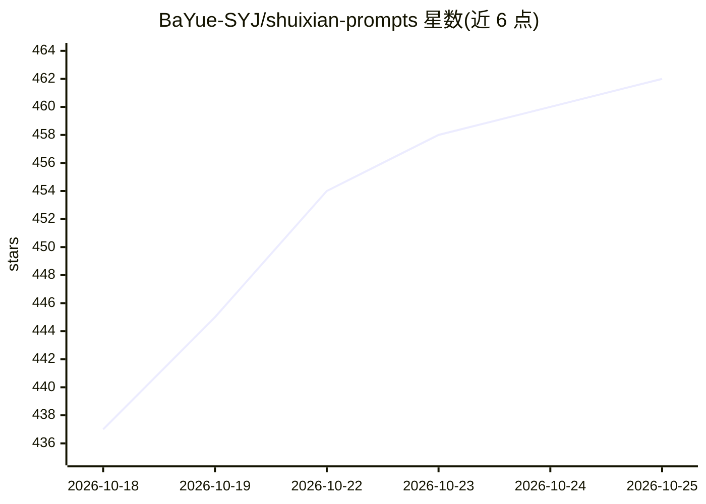

# BaYue-SYJ/shuixian-prompts

⭐ 463 · JavaScript · NOASSERTION · 推送 2026-10-17 · [GitHub](https://github.com/BaYue-SYJ/shuixian-prompts) · [官网](https://prompt.qqsrc.com/) · 个人维护 · 中文 README

**5,430 条中文 AI 绘画提示词库：检索/分类/一键复制**

中文 AI 绘画提示词数据集与纯静态检索站点：收录 5,430 条提示词，按 12 大类、79 细类组织，每条配效果图，支持关键词模糊搜索、拼音首字母、标签分面、命令面板。提供一键复制（带参数的提示词填表生成成品）、收藏合集、Markdown/JSON/CSV 导出。覆盖 Midjourney、Stable Diffusion、Flux、ChatGPT、Gemini 及即梦、可灵、豆包等模型。代码与 JSON 数据开源，图片托管在 Cloudflare R2 不随仓库分发，许可要求署名且商用需授权。

## 筛选速览

| 维度 | 判定 | 备注 |
|---|---|---|
| AI 角色 | `ai-knowledge` | 知识聚合/清单类 |
| 许可风险 | `none` | NOASSERTION |
| 部署形态 | `None` |  |
| 模型依赖 | — | README 未给出锁定关系 |
| 硬件要求 | — | 无带数字的原话,不猜 |
| 安装摩擦 | `low` | 无编译、无系统依赖或容器化 |
| 成熟度 | — | 结构信号不足 |

## 能力要点

- 5,430 条中文提示词，12 大类 79 细类，每条配效果图
- 关键词/拼音首字母/标签分面/⌘K 命令面板多路检索
- 带参数提示词填表后复制成品，收藏合集与多格式导出
- 纯静态自包含站点，可整体部署到任意静态空间

## 适用场景

- 找现成中文提示词直接复制到生图模型使用
- 按媒介/风格/色调分面浏览和筛选提示词
- 本地部署或自建提示词检索站点

## 场景标签

`提示工程` · 领域:Agent 开发

## 证据(README 行号)

> L5: **5,430 条中文 AI 绘画提示词，检索 / 分类 / 一键复制，全部开源**
> L19: 一个**中文 AI 绘画提示词库**：把散落在各处的提示词整理到一起，配上生成效果图，让人能搜到、能看懂、能直接复制去用。
> L21: 提示词覆盖 Midjourney、Stable Diffusion、Flux、ChatGPT、Gemini，以及即梦、可灵、豆包、海螺、文心一格等国产模型。

## 星数曲线

2026-10-18 437 → 2026-10-25 462（+25）

---
*卡片 v1 · prompt 1.4 · 生成 2026-10-21 · 置信度 high · 依据 README sha `66c3a82f0f91` · [字段定义](../../DATASET.md)*
