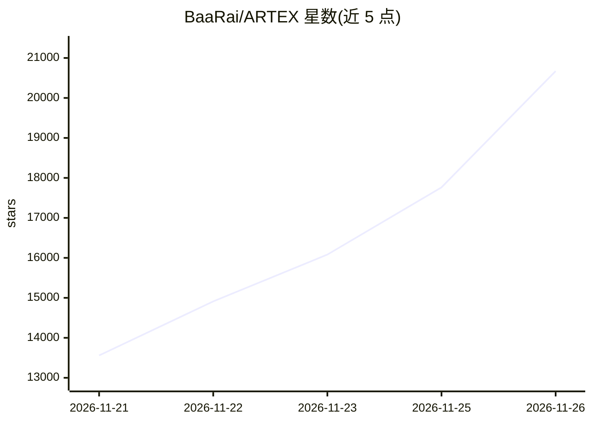

# BaaRai/ARTEX

⭐ 20,672 · Go · AGPL-3.0 · 推送 2026-11-24 · [GitHub](https://github.com/BaaRai/ARTEX) · 组织维护

**自托管的 LLM 多智能体自动化渗透测试平台**

ARTEX 是一个自托管的 LLM 驱动渗透测试平台：planner 将目标拆解为 intent，worker 调用真实工具执行并写回两张关联图（共享资产图与每任务探索图），锚点连接两者形成审计链。每个 finding 绑定 MITM 代理与浏览器扩展捕获的真实 HTTP 请求/响应作为证据，支持复核与漏洞复测循环。自主行为受人工审批门、argv 前缀规则、scope/deny 门、token 与轮次预算及噪声调节器约束。单 Go 二进制内嵌 Next.js UI，依赖 PostgreSQL，支持 Docker 部署，LLM 端点可自选。

## 筛选速览

| 维度 | 判定 | 备注 |
|---|---|---|
| AI 角色 | `ai-native` | 本体是模型或模型工具 |
| 许可风险 | `viral` | AGPL-3.0 |
| 部署形态 | `self-host` | docker 或自建部署 |
| 模型依赖 | local-ok | 支持本地模型 |
| 硬件要求 | — | 无带数字的原话,不猜 |
| 安装摩擦 | `low` | 无编译、无系统依赖或容器化 |
| 成熟度 | — | 结构信号不足 |

## 能力要点

- 双图架构：共享资产图 + 每任务探索图，锚点关联形成审计链
- 录制式 MITM 代理与浏览器扩展将 finding 绑定到具体请求/响应证据
- 人工审批门、argv 前缀规则、scope/deny 门与 token/轮次预算控制自主行为
- LLM profile 故障转移与多 provider worker 轮换，支持本地 Ollama

## 适用场景

- 对授权范围内的目标执行自动化渗透测试并留存证据链
- 对已验证的漏洞发现做复测并跟踪修复状态
- 将 ScopeSentry 等资产数据同步后统一探索测试覆盖面

## 场景标签

`多智能体` `网络安全` · 领域:Agent 开发

## 证据(README 行号)

> L20: ARTEX is a self-hosted, LLM-driven penetration testing platform. It is not a chat wrapper around
> L34: - **Self-hosted and model-agnostic.** One Go binary with the Next.js UI embedded, PostgreSQL,
> L135: The **planner** reads the exploration graph, judges goals, and dispatches intents only when there

## 星数曲线

2026-11-21 13,559 → 2026-11-26 20,672（+7,113）

---
*卡片 v1 · prompt 1.4 · 生成 2026-11-26 · 置信度 high · 依据 README sha `2a04b49e4300` · [字段定义](../../DATASET.md)*
