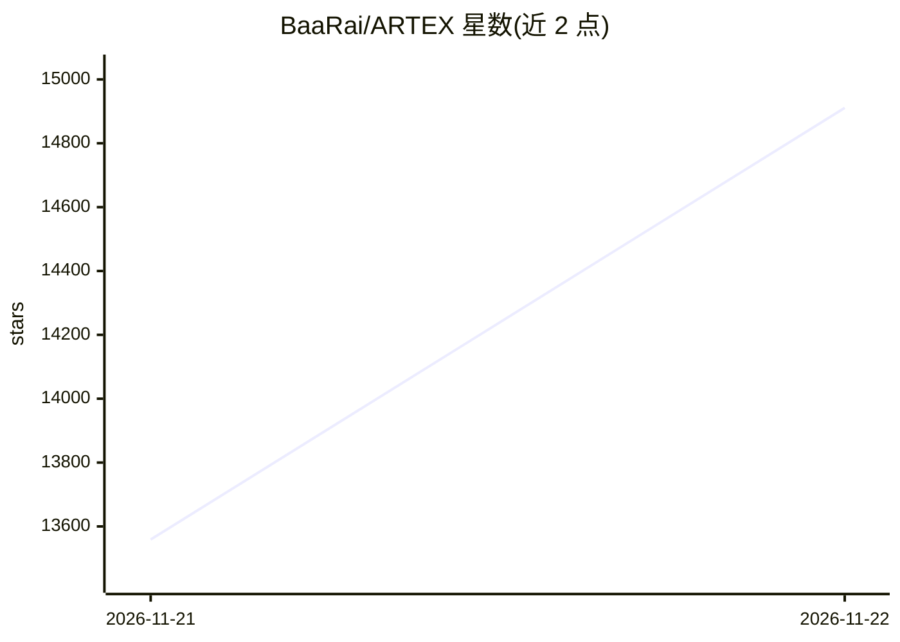

# BaaRai/ARTEX

⭐ 14,911 · Go · AGPL-3.0 · 推送 2026-11-21 · [GitHub](https://github.com/BaaRai/ARTEX) · 个人维护

**自托管多 Agent 自主渗透测试平台：产出带证据的发现**

ARTEX 是一个自托管、LLM 驱动的渗透测试平台：规划器将目标拆解为意图，worker 用真实工具执行并回写资产图与探索图两张关联图谱；每个发现可绑定捕获的请求/响应证据，所有自主动作经过范围规则、人工审批门与预算限制。单个 Go 二进制内嵌 Next.js UI，需 PostgreSQL；LLM 端支持 Anthropic、OpenAI 兼容端点或本地 Ollama，无预构建 Docker 镜像，从检出代码构建。

## 筛选速览

| 维度 | 判定 | 备注 |
|---|---|---|
| AI 角色 | `ai-native` | 本体是模型或模型工具 |
| 许可风险 | `viral` | AGPL-3.0 |
| 部署形态 | `self-host` | docker 或自建部署 |
| 模型依赖 | local-ok | 支持本地模型 |
| 硬件要求 | — | 无带数字的原话,不猜 |
| 安装摩擦 | `low` | 无编译、无系统依赖或容器化 |
| 成熟度 | — | 结构信号不足 |

## 能力要点

- 双图架构：资产图 + 每任务探索图，锚点关联
- MITM 代理与浏览器扩展捕获流量作为发现证据
- 人工审批门、argv 前缀规则、token/轮次预算控制自主性
- 多 LLM 配置轮换与自动故障转移，支持 MCP 服务器扩展

## 适用场景

- 对授权范围内的目标执行自主渗透测试并留存证据链
- 复测漏洞是否已修复并自动更新发现状态
- 公司级资产图谱管理与测试覆盖度可视化

## 场景标签

`多智能体` `网络安全` · 领域:Agent 开发

## 证据(README 行号)

> L19: ARTEX is a self-hosted, LLM-driven penetration testing platform. It is not a chat wrapper around
> L23: justify it, and every autonomous action passes through scope rules, approval gates and budgets.

## 星数曲线

2026-11-21 13,559 → 2026-11-22 14,911（+1,352）

---
*卡片 v1 · prompt 1.4 · 生成 2026-11-22 · 置信度 high · 依据 README sha `1961a70640be` · [字段定义](../../DATASET.md)*
