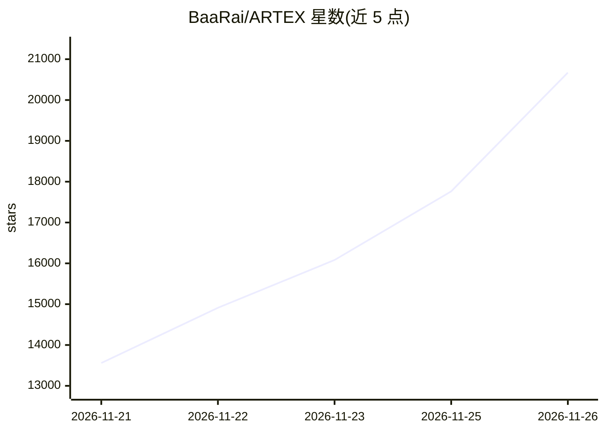

# BaaRai/ARTEX

⭐ 20,672 · Go · AGPL-3.0 · 推送 2026-11-24 · [GitHub](https://github.com/BaaRai/ARTEX) · 个人维护

**自托管多 Agent 自主渗透测试平台，产出带证据链的发现**

自托管的 LLM 驱动渗透测试平台：planner 将目标拆解为 intents，workers 用真实工具执行并把结果写回资产图与探索图两张关联图；每条发现可绑定捕获的 HTTP 请求/响应作为证据，所有自主动作经过范围规则、审批门与预算控制。单 Go 二进制内嵌 Next.js UI，依赖 PostgreSQL，支持 Anthropic、OpenAI 兼容端点与本地 Ollama，带 MITM 流量录制代理、浏览器扩展捕获、复测循环与报告导出。

## 筛选速览

| 维度 | 判定 | 备注 |
|---|---|---|
| AI 角色 | `ai-native` | 本体是模型或模型工具 |
| 许可风险 | `viral` | AGPL-3.0 |
| 部署形态 | `self-host` | docker 或自建部署 |
| 模型依赖 | local-ok | 支持本地模型 |
| 硬件要求 | — | 无带数字的原话,不猜 |
| 安装摩擦 | `low` | 无编译、无系统依赖或容器化 |
| 成熟度 | — | 结构信号不足 |

## 能力要点

- 双图架构：共享资产图 + 每任务探索图，由锚点关联并计算资产测试覆盖
- MITM 录制代理与浏览器扩展捕获真实流量，发现绑定请求/响应证据
- 人工审批门、argv 前缀规则、范围/预算限制与工具输出的注入防护边界
- 多 provider worker 轮换与故障转移（Anthropic/OpenAI 兼容/Ollama）

## 适用场景

- 对授权范围内的目标做自主渗透测试并保留可审计证据
- Bug bounty 项目中管理资产覆盖与发现复测
- 需要人工审批关键工具调用的团队渗透流程

## 场景标签

`多智能体` `网络安全` · 领域:Agent 开发

## 证据(README 行号)

> L17: ARTEX is a self-hosted, LLM-driven penetration testing platform. It is not a chat wrapper around
> L132: The **planner** reads the exploration graph, judges goals, and dispatches intents only when there

## 星数曲线

2026-11-21 13,559 → 2026-11-26 20,672（+7,113）

---
*卡片 v1 · prompt 1.4 · 生成 2026-11-24 · 置信度 high · 依据 README sha `9cb1b7f90616` · [字段定义](../../DATASET.md)*
